# G19 Monitor

**Une deuxième vie pour l'écran couleur du clavier Logitech G19.** Les infos du PC, les jeux,
la musique, Discord, Steam, les agents Claude Code… sur l’écran 320×240 du clavier, avec 19
thèmes, un menu au clavier et un utilitaire de réglages. Windows, Python.

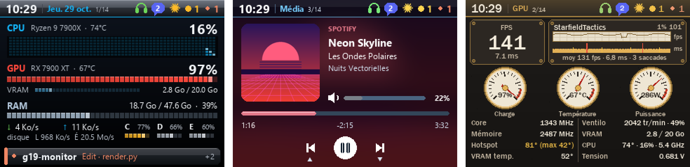

<sub>Captures faites avec des données de démonstration (`python tools/readme_shots.py`).</sub>

## Sommaire

- [Aperçu](#aperçu) · [Thèmes](#thèmes) · [Installation](#installation) ·
  [Mises à jour](#mises-à-jour-automatiques) · [Utilisation](#utilisation) ·
  [Pages](#pages-en-détail) · [Fonctions](#fonctions) · [Sources](#sources-et-prérequis) ·
  [Développement](#développement)

## Aperçu

<table>
<tr>
<td align="center">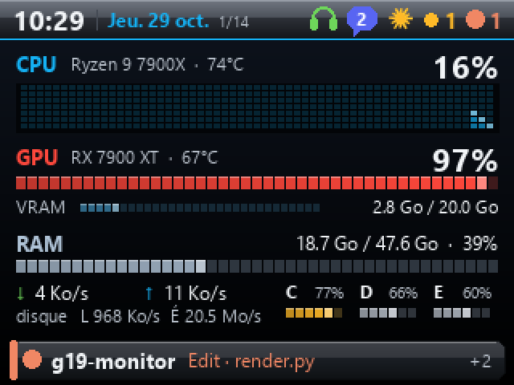<br><b>Système</b> — CPU, GPU, RAM, réseau, disques</td>
<td align="center">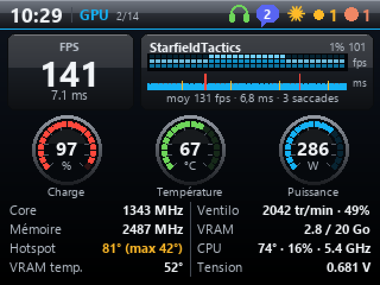<br><b>GPU en jeu</b> — FPS et temps d'image en direct</td>
<td align="center">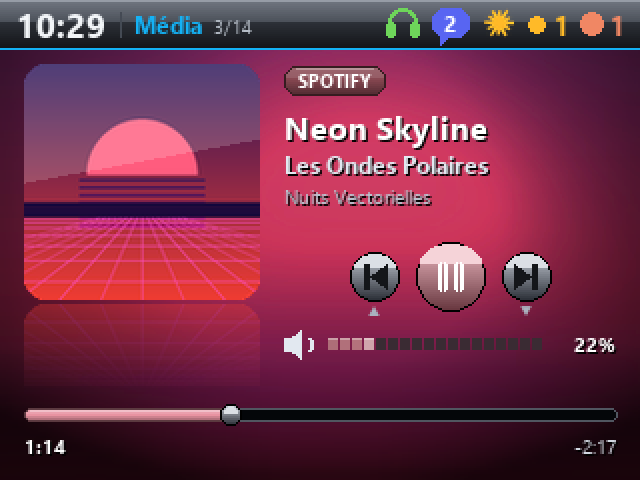<br><b>Média</b> — pochette, progression, paroles</td>
</tr>
<tr>
<td align="center">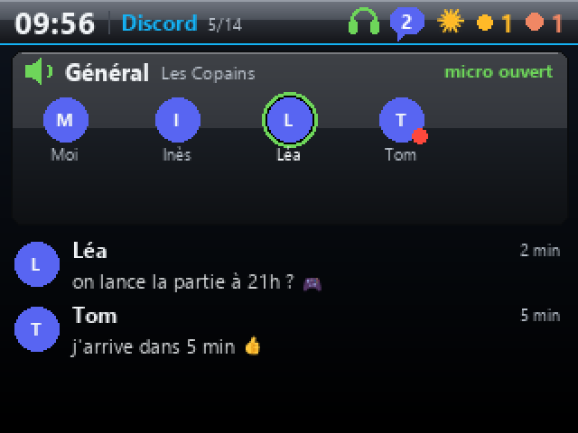<br><b>Discord</b> — salon vocal, qui parle, messages</td>
<td align="center">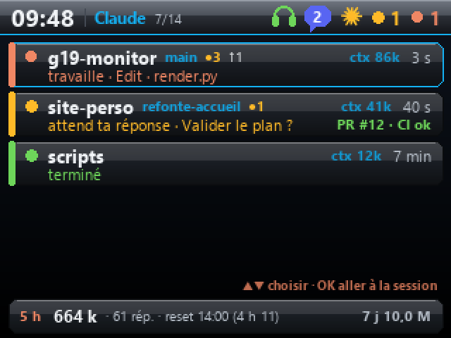<br><b>Claude Code</b> — sessions, contexte, git, usage</td>
<td align="center">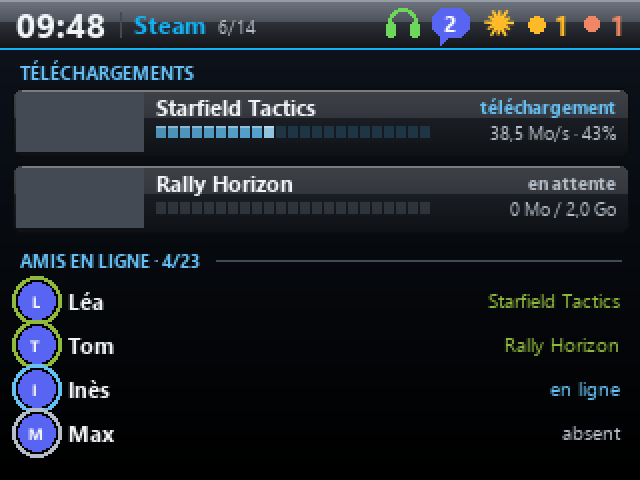<br><b>Steam</b> — téléchargements, amis en ligne</td>
</tr>
<tr>
<td align="center">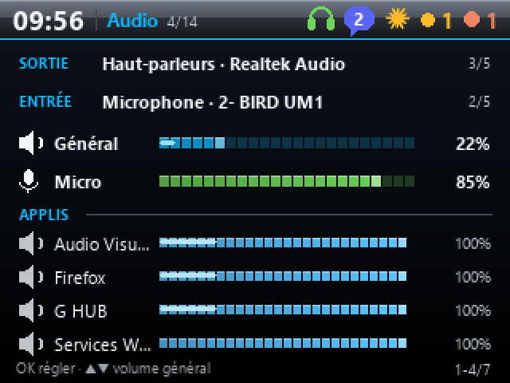<br><b>Audio</b> — sorties, micro, volume par appli</td>
<td align="center">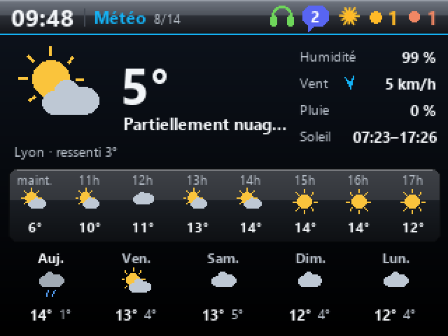<br><b>Météo</b> — maintenant, 8 heures, 5 jours</td>
<td align="center">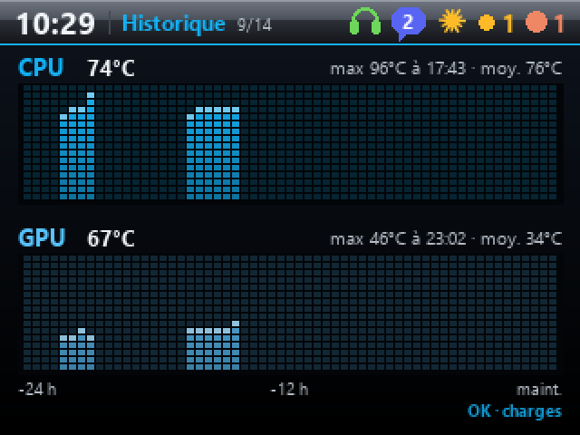<br><b>Historique</b> — températures et charges sur 24 h</td>
</tr>
<tr>
<td align="center">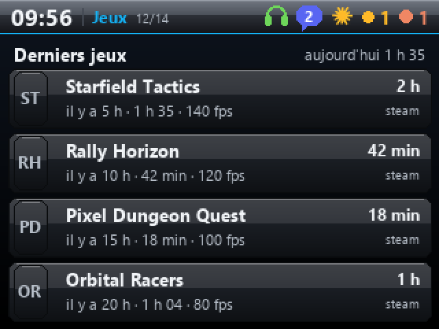<br><b>Jeux</b> — session, temps de jeu, FPS</td>
<td align="center">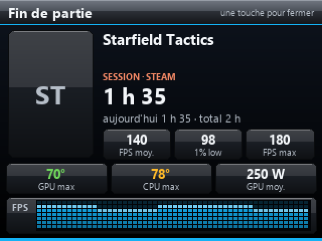<br><b>Fin de partie</b> — durée, FPS, températures</td>
<td align="center">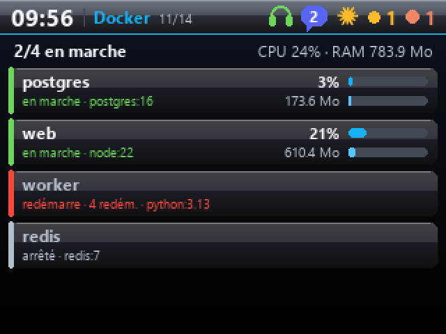<br><b>Docker</b> — conteneurs, CPU, RAM, pannes</td>
</tr>
<tr>
<td align="center">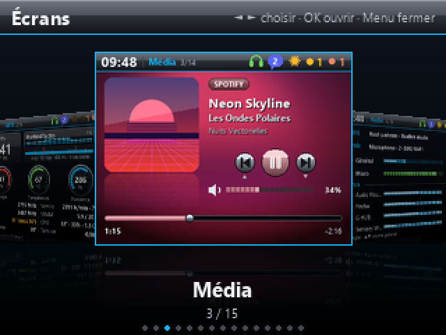<br><b>Carrousel</b> (touche Menu) — tous les écrans</td>
<td align="center">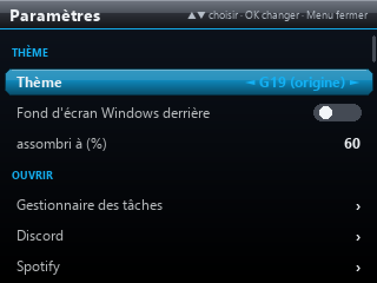<br><b>Réglages</b> sur le clavier</td>
<td align="center">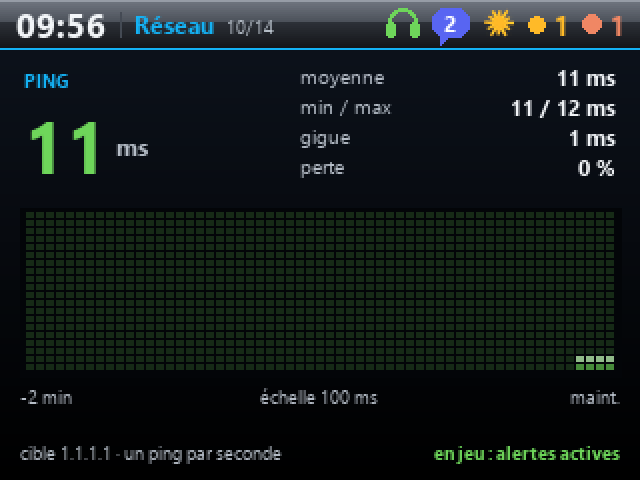<br><b>Réseau</b> — ping, gigue, pertes en jeu</td>
</tr>
<tr>
<td align="center">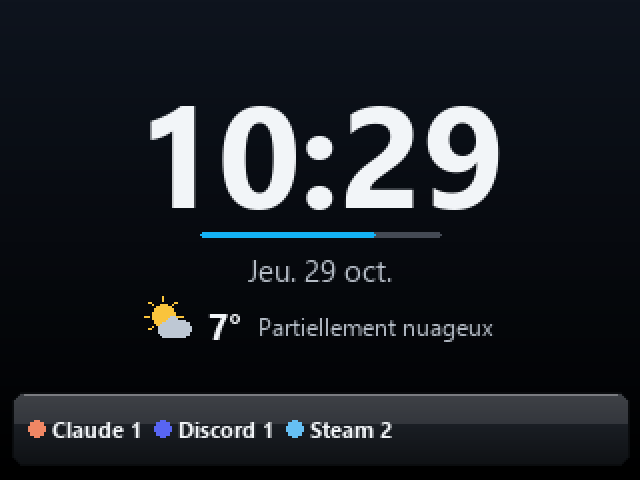<br><b>PC au repos</b> — horloge et météo</td>
<td align="center">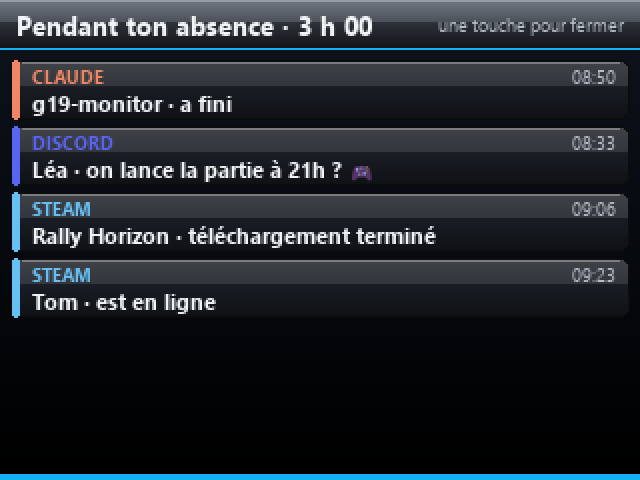<br><b>Au retour</b> — ce qui s'est passé</td>
<td align="center">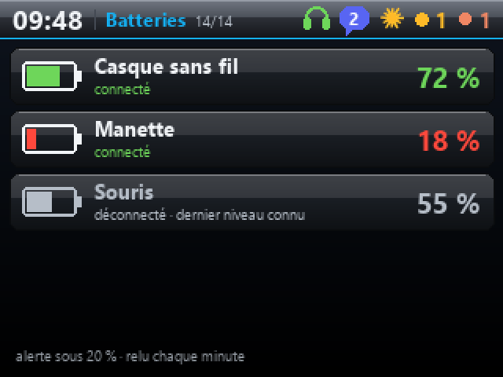<br><b>Batteries</b> — casque, manette…</td>
</tr>
</table>

Et aussi : cœurs du CPU, notifications Windows, test de débit, VPN (Tailscale…), recopie en
direct d'un écran du PC, panneau des ventilateurs, bandeaux qui glissent depuis le bas
(messages, amis, périphériques, alertes…).

## Thèmes

Dix-neuf thèmes, au choix dans le menu du G19 ou l’utilitaire (qui prend les mêmes couleurs).
Certains ne changent que les couleurs ; d'autres changent la forme des éléments : panneaux
vernis et LED du **G19 (origine)**, verre d'**Aero**, aiguilles des **Cadrans analogiques**,
coins de cadre du **HUD cockpit**, contours lumineux de **Tron**, hachures des **Papiers**,
blocs du **Pixel 8 bits**, barre de titre bleue et barres de progression de **Windows XP**.

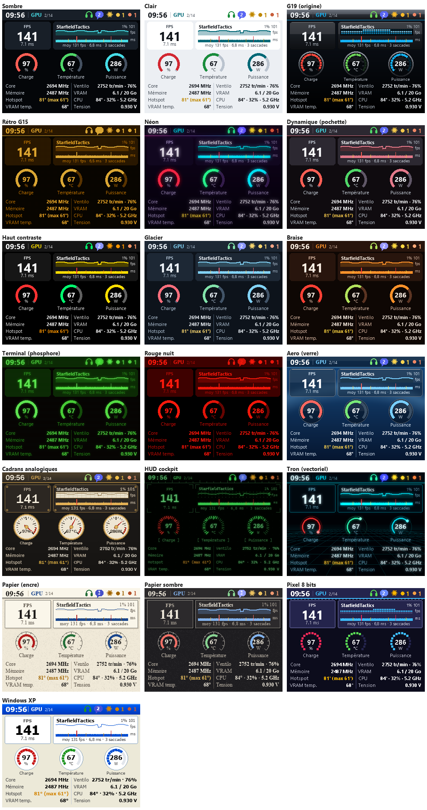

- **Fond d'écran** : en option dans tous les thèmes, le fond d'écran Windows flouté derrière
  les pages, chaque thème gardant son style (panneaux légèrement translucides).
- **Mode nuit** : écran assombri et thème imposé entre deux heures (le thème **Rouge nuit**
  n'éblouit pas).
- **Émojis** en couleur partout (messages, titres, pseudos).

## Installation

### Sur ce PC (pour développer)

```bash
git clone https://github.com/fauwzk/g19-monitor.git
cd g19-monitor
pip install -r requirements.txt
```

Puis double-clic sur `start_g19.pyw` (pas de console). Réglages : `config_g19.pyw`, ou clic sur
l'icône de la zone de notification.

### Sur un autre PC (installateur)

1. `python build_package.py` crée `dist\G19Monitor-AAAAMMJJ.zip`.
2. Sur l'autre PC : décompresser, double-clic sur **`Installer.cmd`**. Il trouve Python (ou
   propose de l'installer), récupère le code depuis GitHub (et propose Git si besoin), installe
   les bibliothèques, crée les raccourcis (Bureau, menu Démarrer) et propose le démarrage avec
   Windows et le voyant Claude Code. Il propose aussi d'installer **Logitech Gaming Software**
   et **LibreHardwareMonitor** (winget), et règle LHM : serveur web limité à ce PC, démarrage
   réduit, lancement à l'ouverture de session avec ses droits administrateur. L'appli elle-même
   n'a pas besoin des droits administrateur ; LGS, LHM et Git les demandent à leur installation.
3. Réglages : *Système → Exporter* sur le premier PC, *Importer* sur le second.

`Desinstaller.cmd` retire tout (les réglages peuvent être gardés).

### Prérequis

| | |
|---|---|
| **Logitech Gaming Software** | indispensable : l'écran passe par son SDK LCD (proposé par l'installateur) |
| **Python 3.10+** | et `pip install -r requirements.txt` |
| MSI Afterburner + RivaTuner | capteurs GPU, FPS et temps d'image en jeu |
| LibreHardwareMonitor | capteurs complémentaires et pilotage des ventilateurs (proposé et réglé par l'installateur ; sinon *Options → Remote Web Server → Run*) |
| Discord, Steam, Docker, Sunshine / Parsec | pour les pages et bandeaux correspondants |

## Mises à jour automatiques

Le dossier de l'appli est une copie de ce dépôt. Toutes les 15 minutes, l'appli regarde s'il y
a du nouveau sur GitHub :

- **rien de modifié localement** → elle se met à jour (en installant d'abord les nouvelles
  bibliothèques s'il y en a), se relance et affiche « G19 Monitor mis à jour » ;
- **modifications locales** (on édite sur ce PC) → rien n'est écrasé, un bandeau prévient.

Il suffit donc de modifier le code sur un PC et de le pousser sur GitHub : l'autre suit.
Réglages : « Mises à jour auto » et « Vérifier les mises à jour » dans le menu du G19, ou la
carte *Mises à jour* de l'onglet Système de l'utilitaire.

## Utilisation

| Touche du G19 | Action |
|---|---|
| ◄ ► | page précédente / suivante |
| Menu | carrousel des écrans ; sa dernière carte ouvre les réglages |
| OK, ▲ ▼ | action de la page (paroles, vue des graphes, session Claude, muet Discord…) |
| Annuler | première page, ou fermer |

- **Utilitaire** (`config_g19.pyw`) : pages et leur ordre, thème, écran du G19 (luminosité,
  contraste, gamma…), bandeaux, mode nuit, alertes et rétroéclairage, raccourcis, Discord,
  Steam, ventilateurs, sauvegarde des réglages. L'aperçu « ● G19 en direct » montre l'écran du
  clavier, et le pavé dessous le pilote comme le vrai clavier.
- **Zone de notification** : icône avec l'état de Claude et les messages non lus ; menu pour
  choisir la page, ouvrir le journal, redémarrer ou quitter.

## Pages en détail

| Page | Contenu | Boutons |
|---|---|---|
| **Système** | CPU (+ historique), GPU, VRAM, RAM, réseau, disques, encart Claude | OK : ventilateurs |
| **GPU** | FPS, temps d'image ; en jeu, graphe des FPS (échelle resserrée : les chutes se voient) et des temps d'image (une barre par image : orange au-delà de 1,5× la médiane, rouge pour une saccade), FPS moyen, 1 % low, saccades ; jauges charge / température / puissance, fréquences, hotspot, VRAM, ventilo, CPU, tension | OK (en jeu) : les deux graphes → FPS → temps d'image |
| **Jeux** | En jeu : pochette, launcher, durée, temps du jour et total, FPS, températures max, courbe des FPS. Sinon : derniers jeux | |
| **Steam** | Téléchargements et mises à jour en cours (progression et vitesse en direct d'après `steamapps\downloading`, tailles d'après les manifestes et `logs\content_log.txt`) ; amis en ligne et leur jeu (clé d'API Web Steam dans l'utilitaire) | ▲ ▼ défiler · OK liste d'amis |
| **Média** | Pochette, titre, artiste, progression, volume + vumètre, accent tiré de la pochette ; paroles synchronisées (LRCLIB) | ▲ préc. · OK paroles · ▼ suiv. |
| **Audio** | Sortie et entrée par défaut de Windows, volume général et micro avec vumètres, volume de chaque appli, appliqués au système | ▲ ▼ volume · OK régler · ◄ ► valeur |
| **Discord** | Salon vocal (qui parle, qui est muet), état du micro, derniers messages ; casque et micro dans le bandeau du haut tant que Discord est ouvert | OK muet · ▲ sourdine |
| **Claude** | Sessions Claude Code avec leur contexte, l'état git de leur dossier (branche, fichiers modifiés, commits à pousser / tirer, PR et CI via `gh`), usage du bloc de 5 h et des 7 jours | ▲ ▼ choisir · OK aller à la session |
| **Notifs** | Notifications Windows de toutes les applis | OK effacer |
| **Météo** | Conditions actuelles, 8 heures, 5 jours (Open-Meteo) ; ville réglée, sinon d'après l'IP | |
| **VPN** | Tailscale (état, IP, nœud de sortie, appareils), autres VPN, IP publique | OK connecter / couper |
| **Débit** | Test de débit Cloudflare en direct ; historique dans `speedtests.csv` | OK lancer / annuler |
| **Cœurs** | Charge par thread, température et fréquence CPU | |
| **Historique** | 24 h, une mesure par minute : températures ou charges CPU et GPU, max et moyenne | OK températures / charges |
| **Batteries** | Appareils Bluetooth et leur batterie ; bandeau sous 20 % | |
| **Réseau** | Ping chaque seconde : latence, gigue, pertes, 2 min de graphe ; bandeau en jeu sur un pic | |
| **Docker** | Conteneurs : état, CPU, RAM, code de sortie, redémarrages ; bandeau en cas de panne ou de redémarrage en boucle | ▲ ▼ défiler |
| **Écran PC** | Recopie en direct (~55 i/s) d'un écran du PC, avec le curseur | OK écran suivant · ▲ ▼ zoom |

Les pages Discord et Docker sont masquées tant que l'appli ne tourne pas, et reviennent seules
(avec un bandeau). Le bandeau du haut montre la page, sa position, le voyant Claude (🟠 travaille
· 🟡 attend · 🟢 terminé), Discord, les alertes et un voyant rouge pendant une session de
streaming entrante.

## Fonctions

**Alertes et rétroéclairage.** Seuils réglables (hotspot GPU, températures, RAM, VRAM, disques) :
bandeau, cadre rouge clignotant. Le rétroéclairage du clavier sert de voyant : rouge pendant une
alerte, pulsation jaune quand Claude attend une réponse, vert quand il a fini, bleu pour un
message Discord, blanc pour une notification Windows. Couleur, nombre de clignotements et
vitesses réglables, boutons « Tester » (qui jouent la couleur affichée, même pas enregistrée).

**Ventilateurs.** Profils auto (GCC) / silencieux / équilibré / performance / maximum via
LibreHardwareMonitor. Sécurités : la pompe et le ventilateur GPU ne sont jamais touchés, 30 %
minimum, retour en auto au-delà de 85 °C CPU ou 95 °C hotspot GPU (seuils réglables), puis
retour au profil choisi une fois refroidi ; auto à la fermeture de l'appli.

**Bandeaux.** Messages Discord, notifications Windows, arrivée / départ dans l'appel, changement
de morceau, périphérique connecté (avec sa batterie), casque ou micro branché / retiré, ami
Steam en ligne, réseau en jeu, streaming entrant (Moonlight / Parsec), conteneur Docker en
panne, nouveau pilote AMD, alertes système (redémarrage requis, disque presque plein).

**PC au repos.** Écran verrouillé ou inactif : grande horloge, météo et compteur de ce qui
arrive ; au retour, un écran « Pendant ton absence » résume messages, amis, téléchargements
terminés, agents Claude qui ont fini…

**Écran du G19.** Luminosité, contraste, gamma, saturation et netteté appliqués à chaque image,
mire de réglage, jusqu'à 60 images/s.

**Fiabilité.** Chien de garde (boucle figée : piles notées, ventilateurs en auto, relance),
tâche en erreur sautée sans arrêter l'appli, relance automatique quand le code change (un code
cassé est refusé), réglages enregistrés champ par champ avec copie de secours et journal
(`settings_changes.log`).

## Sources et prérequis

- **MSI Afterburner** + **RTSS** : capteurs GPU/CPU, FPS et temps d'image. Désactiver
  l'affichage LCD Logitech d'Afterburner pour éviter un doublon.
- **LibreHardwareMonitor** : capteurs complémentaires et ventilateurs.
- **Jeux, tous launchers** : détectés par RTSS ; nom et pochette via Steam, Epic, Xbox, les
  programmes installés ou l'exe.
- **Discord** : RPC local avec ta propre application Discord (onglet Discord de l'utilitaire).
- **Steam** : manifestes et journaux locaux ; amis via l'API Web Steam (clé personnelle).
- **Claude Code** : hooks (`install_hooks.py`, ou case dans l'utilitaire) qui écrivent l'état
  de chaque session dans `~/.claude/g19/sessions/`.
- **Média, volume, notifications** : API Windows (SMTC, Core Audio, notifications).

Les données de l'appli (réglages, accès Discord, clé Steam, historiques) vivent dans
`%LOCALAPPDATA%\G19Monitor`, hors du dossier du code : ni les mises à jour ni le dépôt n'y
touchent.

## Développement

| | |
|---|---|
| `g19_monitor.py` | boucle principale : capteurs, touches, rendu, LCD |
| `g19/render.py` | toutes les pages et thèmes (PIL) ; `g19/looks.py` pour les thèmes qui changent les formes |
| `g19/*.py` | une source par fichier (GPU, Discord, Steam, média, audio, Docker…) |
| `config_g19.pyw` | utilitaire de réglages (tkinter) |
| `g19/updater.py` | mises à jour depuis ce dépôt |
| `build_package.py`, `installer/` | paquet d'installation pour un autre PC |
| `tools/readme_shots.py` | captures de ce README, avec des données de démonstration |

- `python g19_monitor.py --preview dossier` rend toutes les pages en PNG sans clavier ;
  `--stop` / `--restart` arrêtent ou relancent l'instance en cours.
- L'appli se relance d'elle-même quand un fichier `.py` change ; un code qui ne compile pas est
  refusé et noté dans `g19.log`.
- **Lancée depuis une session Claude Code**, l'appli peut ne voir qu'une copie isolée de
  `%LOCALAPPDATA%\G19Monitor` (bac à sable de l'agent) : elle le signale par un bandeau. La
  quitter et la relancer depuis Windows.
