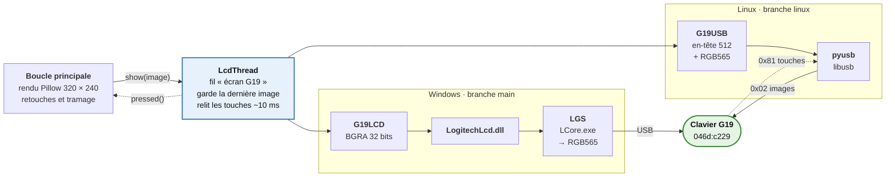
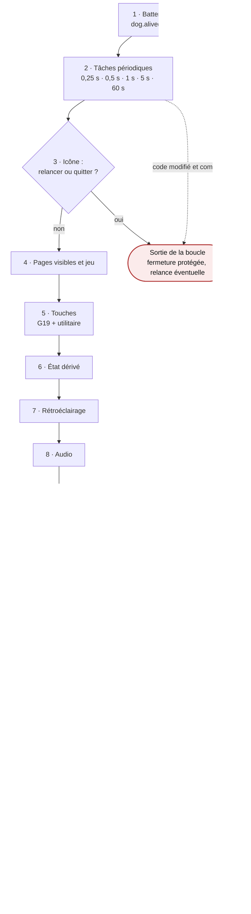
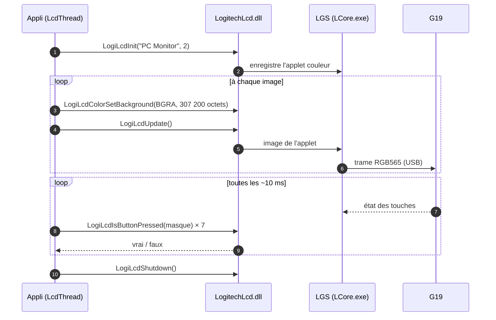
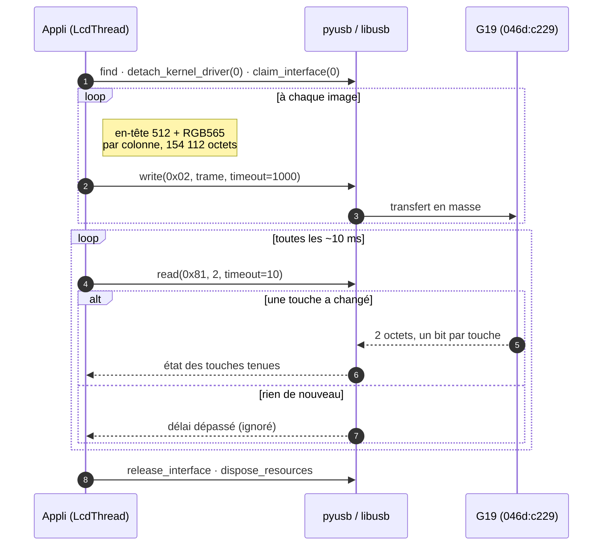
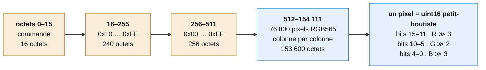
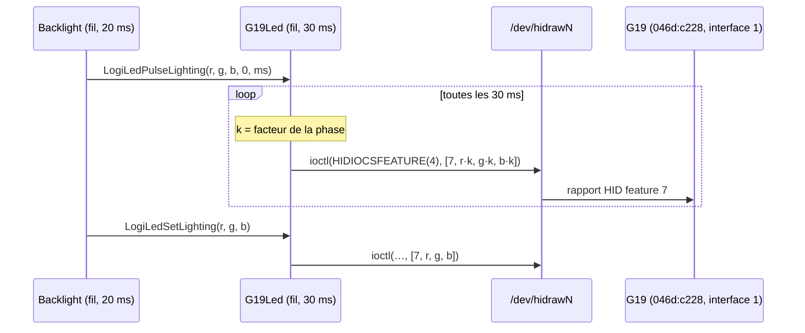

# G19 Monitor — Communication avec le clavier (Windows & Linux)

5 novembre 2026

## Sommaire

1. [Commun](#commun) : matériel, interface commune de la couche écran, boucle principale, comparatif
2. [Windows (branche main)](#windows-branche-main) : SDK Logitech et Logitech Gaming Software
3. [Linux (branche linux)](#linux-branche-linux) : USB direct, hidraw, udev, systemd


## Commun

### Vue d'ensemble

Le même code dessine les écrans sur les deux branches ; seule la couche qui parle au G19 change. Sous Windows (`main`), l'appli est un client des SDK Logitech et passe par Logitech Gaming Software ; sous Linux (`linux`), elle écrit elle-même les trames USB et les rapports HID. Cette partie décrit ce qui est commun ; le détail technique de chaque plateforme est dans les parties [Windows](#windows-branche-main) et [Linux](#linux-branche-linux).

#### Le contrat commun de la couche écran

`G19LCD` (Windows) et `G19USB` (Linux) exposent la même interface ; `LcdThread` et la boucle principale ne savent pas laquelle ils utilisent.

| Membre | Rôle | Windows : `G19LCD` | Linux : `G19USB` |
| --- | --- | --- | --- |
| `show(img)` | déposer une image PIL 320 × 240 | BGRA → `LogiLcdColorSetBackground` | trame 512 + RGB565 → `write(0x02)` |
| `update()` | envoyer l'image déposée | `LogiLcdUpdate()` | rien (déjà parti) |
| `pressed()` | touches nouvellement enfoncées | 7 × `LogiLcdIsButtonPressed` | `read(0x81, 2)` |
| `close()` | libérer l'écran | `LogiLcdShutdown()` | `release_interface` + `dispose_resources` |
| `connected()` | écran présent | `LogiLcdIsConnected(2)` | vrai dès l'ouverture |
| `sent` | images réellement écrites | compteur | compteur |

Le choix se fait sur `os.name` dans `connect_lcd()` de `g19_monitor.py` : `"nt"` → `G19LCD`, sinon → `G19USB`. Le rétroéclairage suit le même principe : `backlight.py` appelle des fonctions `LogiLed…`, servies par la DLL sous Windows et par `G19Led` sous Linux.

### Le matériel G19

Le G19 se présente comme deux appareils USB Logitech (vendeur `046d`) : le clavier `c228` et l'écran `c229`. L'écran fait 320 × 240 pixels en couleur 16 bits, avec 7 touches de navigation autour.

| Élément | Appareil USB | Interface | Accès Linux | Usage |
| --- | --- | --- | --- | --- |
| Écran LCD (images) | `046d:c229` | 0 (classe vendeur) | sortie en masse `0x02` | une image complète par envoi |
| Touches de l'écran | `046d:c229` | 0 | entrée `0x81` | 2 octets à chaque changement |
| Rétroéclairage | `046d:c228` | 1 | `/dev/hidrawN` | rapport HID « feature » n° 7 |
| Touches de frappe | `046d:c228` | 0 | pilote clavier du noyau | non utilisé par l'appli |

Touches de l'écran gérées par l'appli : `menu`, `ok`, `cancel`, `up`, `down`, `left`, `right`. Les claviers à écran monochrome (G15 `c221`/`c222`/`c226`/`c227`, G510 `c22d`/`c22e`, G13 `c21c`) sont reconnus par `g19/keyboards.py`, mais n'ont un pilote que sous Windows (via le SDK).

### Rendu et boucle principale

La boucle de `run()` dessine une image, la dépose dans `LcdThread` et repart sans attendre le clavier ; le fil d'envoi parle seul au G19, images et touches comprises.



Seule la couche sous `LcdThread` change d'une branche à l'autre ; tout ce qui suit est le même code sur `main` et `linux` (`run()` dans `g19_monitor.py`).

#### Démarrage, avant la boucle

1. **Relance en attente** : si `G19_WAIT_PID` est défini (relance par le chien de garde), l'appli attend que l'ancienne instance soit partie.
2. **Instance unique** : `SingleInstance()` ; une instance tourne déjà → sortie immédiate.
3. **Gardien** : `ensure_guard()` le lance s'il ne tourne pas (sous Linux, sans effet : c'est systemd).
4. **Icône** : `Tray()` (pystray, ou icône factice).
5. **Écran** : `connect_lcd()` boucle jusqu'à obtenir `G19LCD` ou `G19USB` (nouvel essai toutes les 5 s). Quittée pendant l'attente → arrêt propre.
6. **Chien de garde** : `Watchdog()` démarre tout de suite et couvre aussi le démarrage.
7. **Écran de démarrage** : `Splash` affiche une barre de progression sur le G19 pendant le chargement des sources (capteurs et services, ventilateurs, média).
8. **Contexte** : `make_ctx()` crée un objet `Ctx` qui regroupe toutes les sources (capteurs, GPU, volume, jeux, Discord, notifications, météo, Steam, agenda…), avec leur version Windows ou Linux selon `os.name`. Certaines lisent leurs données dans leurs propres fils, d'autres sont échantillonnées par la boucle (capteurs, GPU).
9. **Entrées et sorties annexes** : `KeyInbox` (touches de l'utilitaire), `Mirror` (aperçu), `Backlight` (fil du rétroéclairage), `SettingsMenu`, `Coverflow` (liste des écrans), `Transitions`.
10. **Fil d'envoi** : l'écran est enveloppé dans `LcdThread`, puis `next_tick` prend l'heure actuelle.

#### Un tour de boucle

La boucle tourne tant que `quit_requested()` est faux. Chaque tour suit le même ordre ; chaque étape est chronométrée par `LoopClock` (nom de l'étape entre parenthèses).



1. **Battement** : `now = time.time()`, puis `dog.alive(now)` pour le chien de garde (« attente »).
2. **Tâches périodiques** : chacune a sa propre période, voir le tableau ci-dessous (« tâches : … »).
3. **Commandes de l'icône** : `drain(tray)` vide la file des clics sur l'icône : changer de page, lancer un test de débit, appliquer un profil audio, relancer, quitter. Relancer ou quitter sortent de la boucle.
4. **Pages et jeu** (« pages et jeu ») :
   - `visible_pages()` calcule les pages affichables ; une page dont l'appli est fermée disparaît et la page courante passe à sa voisine précédente ; un bandeau annonce une page qui revient.
   - Jeu détecté → bascule sur la page de jeu réglée, en mémorisant la page d'avant.
   - Fin de partie → récapitulatif pendant 20 s (`RECAP_SECONDS`), puis retour à la page d'avant ; sans récapitulatif, retour 5 s après la fin (`BACK_AFTER_GAME`).
5. **Touches** : `lcd.pressed()` puis `keys.pressed()` (utilitaire), traitées une par une dans l'ordre de priorité décrit plus bas.
6. **État dérivé** : la sélection Claude reste visible (défilement), Discord est marqué lu quand sa page est affichée, la page courante est enregistrée quand elle change (`settings.save_state`).
7. **Rétroéclairage** : un nouveau message Discord ou une nouvelle notification déclenche `backlight.flash()` (sauf heures calmes ou « Ne pas déranger ») ; vitesse, couleurs et couleur de repos sont recopiées des réglages ; `backlight.update(état)` donne l'état voulu (alerte, Claude attend, Claude travaille ou normal). Le fil de `Backlight` fait le reste.
8. **Audio** : les changements de périphériques (casque, enceintes, micro) produisent des bandeaux ; `mixer.auto_switch` bascule casque / haut-parleurs ; les résultats des profils audio sont journalisés (« touches et rétroéclairage »).
9. **Rendu** (« rendu ») : un seul écran est dessiné, le premier vrai dans cet ordre : carrousel des écrans, menu des réglages, panneau des ventilateurs, récapitulatif de partie, résumé d'absence, écran de repos, et sinon la page courante (`render(page, c, now)`). `transitions.frame()` ajoute le glissement ou le fondu entre deux écrans, puis `overlay_toast()` pose le bandeau par-dessus la page. Une exception de rendu garde l'image précédente et n'est journalisée qu'une fois par minute.
10. **Retouches** (« retouches ») : mire de réglage si demandée, fenêtre de volume par-dessus (sauf sur la page Audio et l'écran de repos), puis `screen.adjust()` (luminosité, contraste), `night.dim()` (mode nuit) et `screen.dither()` (tramage de Bayer pour le 16 bits).
11. **Envoi** (« envoi au G19 ») : si `now - last_lcd ≥ 0,9 × lcd_step`, l'image part dans `LcdThread` (`lcd.show`). Toutes les 2 s, la fluidité réelle est calculée à partir de `lcd.pushed`, affichée dans le menu et publiée pour l'utilitaire ; la deuxième mesure est écrite dans le journal.
12. **Aperçu** (« aperçu ») : `mirror.write()` copie l'image en mémoire partagée si l'utilitaire la demande.
13. **Attente** : voir *Cadence* ci-dessous.

#### Tâches périodiques

| Période | Tâches |
| --- | --- |
| chaque tour | commandes de l'icône, pages visibles, touches, rétroéclairage, audio, rendu, envoi |
| 0,25 s | FPS du jeu (`gpu.sample_fps()`) ; sur la page GPU en jeu, temps d'image à chaque tour |
| 0,5 s | sessions Claude Code : lecture, rappel si une session attend, clignotement vert quand une session passe de « travaille » à « au repos » |
| 1 s | mode nuit ; capteurs ; GPU ; **ventilateurs** (sécurité thermique, juste après les capteurs) ; jeux ; succès Steam ; alertes ; historique ; réseau ; bandeaux candidats ; absence ; bilan du jour ; infobulle et menus de l'icône |
| 1 s | réglages modifiés sur disque (`watch.poll()`) ; demandes de test de l'utilitaire (mire, couleur, clignotement, mise à jour) ; code source modifié |
| 5 s | Claude et Discord lancés ou non (liste des processus) |
| 60 s | réglage LED de LGS (Windows) ; gardien toujours là |

Un changement du code source arme une relance 1,5 s plus tard (`RELOAD_DELAY`), si plus rien ne change et si le code compile (`sources_compile()`) : la boucle sort avec `restart = True`.

#### Cadence

- **Pas de base** : `lcd_step = 1 / fps` (réglage `fps`, 15 par défaut). Pendant la fenêtre de volume (1,6 s après le dernier changement), au moins 30 images/s pour que la barre glisse.
- **Aperçu ouvert** : le tour descend à 1/60 s pour l'utilitaire, mais le G19 garde son rythme grâce au test `0,9 × lcd_step` de l'étape 11.
- **Échéances** : `next_tick += step`. Un tour un peu en retard est rattrapé au suivant ; un retard supérieur à un pas remet `next_tick` à l'heure actuelle, sans rafale de rattrapage.
- **Réveil anticipé** : l'attente est `c.volume.wake.wait(next_tick - now)`. Un changement de volume pose cet événement et réveille la boucle tout de suite.

#### Priorité des touches

Chaque touche passe ces filtres dans l'ordre ; le premier qui la prend l'arrête (`continue`). Toute touche réveille d'abord le détecteur d'absence (`away.poke`) et allume sa pastille à l'écran.

1. Mire de réglage affichée → la ferme.
2. Récapitulatif de partie → le ferme et revient à la page d'avant le jeu.
3. Résumé d'absence → le ferme.
4. Écran de repos → la touche réveille seulement l'écran.
5. Bandeau affiché : OK ouvre sa page, Annuler le ferme.
6. Carrousel des écrans ouvert → il reçoit la touche (choisir une page, ouvrir les réglages).
7. Panneau des ventilateurs ouvert → gauche / droite / haut / bas changent de profil, OK l'enregistre, Annuler ou Menu ferment.
8. Page Audio ou Discord → leur panneau peut prendre la touche (`mixer.handle`, `discord_panel.handle`).
9. Page Système + OK → ouvre le panneau des ventilateurs.
10. Menu → ouvre le carrousel des écrans.
11. Menu des réglages ouvert → `menu.handle()` ; la commande renvoyée peut ouvrir l'utilitaire, relancer, appliquer un profil audio, ignorer un jeu, tester l'éclairage, lancer une appli.
12. Sinon : gauche / droite changent de page (en boucle) ; Annuler ferme une sous-vue, sinon revient à la première page ; OK et haut / bas font l'action de la page.

| Page | OK | Haut / bas |
| --- | --- | --- |
| Média | paroles affichées / masquées | morceau précédent / suivant |
| Discord | micro coupé | haut : casque coupé |
| Claude | ouvre la session choisie (ou l'appli Claude) | choisir une session |
| GPU | vue suivante du graphe en jeu | — |
| Notifications | « Ne pas déranger », sinon tout effacer | bas : tout effacer |
| Écran | écran suivant | zoom |
| Steam | ouvre la liste d'amis | défiler |
| Maison | action sur l'entité choisie | choisir une entité |
| Agenda | ouvre le lien de la réunion | choisir un événement |
| Bilan du jour | — | jour précédent / suivant (13 jours au plus) |
| VPN, Débit | basculer / lancer | — |
| Historique | températures / charge | — |
| Bandeaux | ouvre le bandeau choisi | choisir |
| Carburant, Docker | relire les prix (Carburant) | défiler |

#### Robustesse

- **`guarded(nom, fn)`** enveloppe chaque tâche : une exception est journalisée au plus une fois toutes les 5 min par tâche et la boucle continue. La durée la plus longue de chaque tâche est notée.
- **`LoopClock`** cumule le temps de chaque étape et écrit toutes les 600 s une ligne « boucle : tours/s, images/s, ms par étape, tâches les plus lentes » dans `g19.log`.
- **`Watchdog`** vérifie le battement toutes les 5 s. Boucle figée depuis 45 s (blocage dans un pilote ou une DLL) : piles de tous les fils dans le journal, ventilateurs rendus à l'automatique, nouvelle instance lancée avec `--reloaded`. Un trou de plus de 15 s entre deux vérifications est pris pour une sortie de veille, pas pour un blocage.
- **Fermeture** : historique, bilan, jeux, ventilateurs, rétroéclairage, écran et icône sont fermés un par un, chacun protégé par son propre `try`.
- **Après un plantage** : si le gardien tourne, il relance l'appli ; sinon l'appli attend que le code soit modifié et compile, puis se relance d'elle-même. Une sortie volontaire pose l'événement « arrêt voulu » pour que le gardien ne relance pas.

### Windows et Linux côte à côte

| Aspect | Windows (`main`) | Linux (`linux`) |
| --- | --- | --- |
| Logiciel requis | Logitech Gaming Software lancé | aucun (règle udev) |
| Écran | `LogitechLcd.dll`, `G19LCD` | pyusb / libusb, `G19USB` |
| Format envoyé par l'appli | BGRA 32 bits, 307 200 octets | en-tête 512 + RGB565 par colonne, 154 112 octets |
| Touches | `LogiLcdIsButtonPressed(masque)` | endpoint `0x81`, 2 octets |
| Rétroéclairage | `LogitechLed.dll`, effets animés par LGS | `hidraw`, rapport feature 7, effets animés par l'appli |
| Écrans monochromes (G15, G510, G13) | oui (`MonoLCD`) | non |
| Démarrage et relance | gardien `g19/guard.py` | service systemd utilisateur |
| Instance unique | mutex nommés | verrou + fichiers-signaux |
| FPS des jeux | RTSS | non disponible |

## Windows (branche main)

### Chaîne logicielle

Sous Windows, l'appli n'ouvre jamais l'USB elle-même : elle est un client du SDK Logitech, et c'est Logitech Gaming Software (processus `LCore.exe`) qui possède le clavier et lui parle.

| Couche | Composant | Rôle |
| --- | --- | --- |
| Appli | `g19/lcd.py` (`G19LCD`, `LcdThread`, `MonoLCD`) | rend l'image, appelle le SDK par `ctypes` |
| Appli | `g19/backlight.py` (`Backlight`) | pilote l'éclairage par le SDK LED |
| SDK | `LogitechLcd.dll`, `LogitechLed.dll` (x64) | bibliothèques client ; transmettent à LGS |
| Service | LGS (`LCore.exe`) | gère les applets, convertit l'image, anime les effets, parle USB au G19 |
| Pilote | pilote HID / USB de Logitech | transport vers `046d:c228` et `046d:c229` |

Conséquences directes : LGS doit tourner, ses réglages comptent (option LED SDK), et plusieurs applets peuvent se partager l'écran (LGS fait la rotation). Le format réel des trames USB n'est jamais vu par l'appli côté Windows.

Échanges pour une image et les touches :



### SDK LCD : `LogitechLcd.dll`

`_load_dll()` essaie dans l'ordre : la variable d'environnement `G19_LCD_DLL`, puis `C:\Program Files\Logitech Gaming Software\SDK\LCD\x64\LogitechLcd.dll`, puis `…\LCDSDK\Lib\x64\LogitechLcd.dll`. Elle est chargée par `ctypes.CDLL` (convention cdecl) ; aucune trouvée → `FileNotFoundError`.

| Fonction | `argtypes` | `restype` | Usage dans l'appli |
| --- | --- | --- | --- |
| `LogiLcdInit` | `c_wchar_p` nom, `c_int` type | `c_bool` | enregistre l'applet « PC Monitor », type 2 (couleur) |
| `LogiLcdIsConnected` | `c_int` type | `c_bool` | un écran de ce type est-il branché |
| `LogiLcdColorSetBackground` | `POINTER(c_ubyte)` | `c_bool` | dépose l'image BGRA 320 × 240 |
| `LogiLcdIsButtonPressed` | `c_int` masque | `c_bool` | état d'une touche, au moment de l'appel |
| `LogiLcdUpdate` | — | `None` | envoie au clavier l'image déposée |
| `LogiLcdShutdown` | — | `None` | désenregistre l'applet |
| `LogiLcdMonoSetBackground` | `POINTER(c_ubyte)` | `c_bool` | image 160 × 43 (applet monochrome) |

Cycle de vie d'une applet :

1. `LogiLcdInit("PC Monitor", 2)`. `False` = LGS absent ou pas prêt → `RuntimeError`.
2. Par image : `LogiLcdColorSetBackground(buf)` puis `LogiLcdUpdate()`.
3. Par lecture des touches : un `LogiLcdIsButtonPressed(masque)` par touche (7 appels).
4. À la fermeture : `LogiLcdShutdown()`.

Le SDK n'est pas prévu pour être appelé depuis deux fils : tous les appels passent par le même fil (voir *Fil d'envoi*).

### Image et touches côté SDK

#### Image

Le SDK attend un tampon de 320 × 240 × 4 = **307 200 octets**, lignes de haut en bas, pixels de gauche à droite, chaque pixel en ordre **B, G, R, A**. L'appli le prépare ainsi :

```python
data = img.convert("RGBA").tobytes("raw", "BGRA")   # Pillow réordonne les canaux
if data == self._last:                                  # image identique : rien n'est envoyé
    return
ctypes.memmove(self._buf, data, len(data))              # _buf = (c_ubyte * 307200)() alloué une fois
dll.LogiLcdColorSetBackground(self._buf)
```

Le tampon ctypes est alloué une seule fois à l'ouverture et réécrit par `memmove` : aucune allocation par image. Le canal alpha est envoyé mais l'écran n'a pas de transparence. La réduction en 16 bits (RGB565) est faite par LGS ; l'appli applique quand même son tramage de Bayer (`screen.dither()`, pas 8 / 4 / 8) avant, pour que la réduction ne crée pas de bandes.

#### Touches

| Touche | Masque SDK |
| --- | --- |
| left | `0x0100` |
| right | `0x0200` |
| ok | `0x0400` |
| cancel | `0x0800` |
| up | `0x1000` |
| down | `0x2000` |
| menu | `0x4000` |

Le SDK donne l'état « tenu / relâché », pas les appuis. `pressed()` construit l'ensemble des touches tenues, le compare au précédent et ne renvoie que la différence (front montant) :

```python
held = {n for n, m in BUTTONS.items() if dll.LogiLcdIsButtonPressed(m)}
new = held - self._held
self._held = held
```

Une touche maintenue ne compte donc qu'une fois, et un appui plus court que l'intervalle entre deux lectures (10 ms) peut être manqué.

### Fil d'envoi et reconnexion

Un couple `SetBackground` + `Update` coûte 4 à 30 ms côté LGS. Pour que la boucle de rendu ne l'attende pas, `LcdThread` (dans `g19/lcd.py`) enveloppe `G19LCD` et fait **tous** les appels au SDK dans un fil dédié nommé « écran G19 ».

- **Boîte à une place** : `show(img)` range l'image dans `_frame` sous un `threading.Condition` et réveille le fil. Une image arrivée avant que la précédente soit partie la remplace : LGS lent → images sautées, jamais de retard qui s'accumule.
- **Boucle du fil** : attend une image au plus `POLL` = 10 ms ; envoie l'image s'il y en a une (`show` + `update`, `pushed += 1`) ; lit les touches dans tous les cas ; ajoute les nouvelles à `_presses`.
- **Touches** : `pressed()` côté boucle vide `_presses` sous le verrou. Les touches sont donc lues environ toutes les 10 ms même sans nouvelle image.
- **Erreurs** : `OSError` et `ValueError` d'un appel SDK sont ignorées, le fil continue.
- **Mesure** : `pushed` compte les images réellement parties ; la boucle en déduit la fluidité réelle toutes les 2 s.
- **Arrêt** : `close()` lève `_stop`, attend le fil 2 s au plus, puis `LogiLcdShutdown()`.

#### Attente de LGS

`connect_lcd()` (`g19_monitor.py`) crée `G19LCD("PC Monitor")` en boucle : sur `OSError` ou `RuntimeError` (DLL absente, `LogiLcdInit` refusé), il écrit un avertissement unique dans le journal, met l'infobulle de l'icône à « en attente de Logitech Gaming Software » et réessaie toutes les 5 s, en surveillant une demande d'arrêt. C'est le cas typique juste après l'ouverture de session, quand LGS démarre après l'appli.

Une fois l'applet enregistrée, débrancher puis rebrancher le clavier n'est pas traité par l'appli, qui n'appelle pas LogiLcdIsConnected dans sa boucle : c'est LGS qui retrouve le clavier.

### SDK LED : `LogitechLed.dll`

Chemin : `G19_LED_DLL`, sinon `C:\Program Files\Logitech Gaming Software\SDK\LED\x64\LogitechLed.dll`, chargée par `ctypes.CDLL`. Les couleurs sont en **pourcentages** (0–100), les durées en ms.

| Fonction | `argtypes` | Usage |
| --- | --- | --- |
| `LogiLedInit` | — | ouvre la connexion à LGS |
| `LogiLedSetTargetDevice` | `c_int` | cible `0x3` = RGB \| MONOCHROME |
| `LogiLedSaveCurrentLighting` | — | mémorise l'éclairage du profil avant le premier effet |
| `LogiLedRestoreLighting` | — | réapplique l'éclairage mémorisé |
| `LogiLedSetLighting` | `c_int` × 3 (r, g, b) | couleur fixe |
| `LogiLedFlashLighting` | `c_int` × 5 (r, g, b, durée, intervalle) | clignotement animé par LGS |
| `LogiLedPulseLighting` | `c_int` × 5 (r, g, b, durée, intervalle) | pulsation animée par LGS |
| `LogiLedStopEffects` | — | arrête l'effet en cours |
| `LogiLedShutdown` | — | ferme la connexion |

Toutes renvoient `c_bool`. La durée passée est `0` (`INFINITE`) : l'effet dure jusqu'au suivant.

#### Connexion et nouvelles tentatives

`Backlight` tourne dans son propre fil, un pas toutes les 20 ms (`TICK`). La connexion n'est ouverte qu'au premier effet voulu :

1. DLL introuvable → nouvel essai dans 30 s.
2. `LogiLedInit()` refusé (LGS fermé, option décochée) → nouvel essai dans 2 s (`RETRY`).
3. Pause de 0,3 s : LGS n'accepte pas les commandes tout de suite.
4. `LogiLedSetTargetDevice(0x3)`.

Un même avertissement n'est écrit qu'une fois toutes les 300 s. La connexion reste ensuite ouverte : la fermer ferait aussi disparaître l'applet de l'écran LCD.

#### Effets

| État | Effet | Couleur (%) | Intervalle |
| --- | --- | --- | --- |
| alert | flash | 100, 0, 0 | 300 ms |
| waiting | pulse | 100, 65, 0 | vitesse réglée |
| working | solid | 100, 40, 0 | — |
| done | blink | 0, 100, 20 | 300 ms |
| discord | blink | 35, 40, 100 | 300 ms |
| notif | blink | 100, 100, 100 | 300 ms |
| remind | blink | 100, 65, 0 | 300 ms |
| whatsapp | blink | 0, 100, 25 | 300 ms |
| snap | blink | 100, 95, 0 | 300 ms |

`flash` et `pulse` sont animés par LGS. `blink` (un nombre fini de clignotements, en file de 4 au plus) est animé par l'appli : `SetLighting` couleur pendant la première moitié de chaque période, noir pendant la seconde. Un clignotement passe devant tout sauf une alerte.

Deux détails de LGS sont contournés : l'arrêt d'un effet est traité en différé et écraserait une couleur posée juste après (d'où `StopEffects` puis 0,15 s d'attente) ; et `SaveCurrentLighting` peut mémoriser la dernière couleur posée par le SDK lui-même, d'où une couleur de repos fixe (blanc par défaut) plutôt qu'une restauration.

L'option de LGS « Autoriser les jeux à contrôler l'éclairage » est lue dans `%LOCALAPPDATA%\Logitech\Logitech Gaming Software\settings.json` (`mainwindow.enableLEDSDK`). Décochée, LGS accepte les commandes sans rien appliquer et sans erreur : l'appli la lit pour pouvoir le signaler.

### Écrans monochromes (G15, G510, G13)

`MonoLCD` utilise la même DLL avec une seconde applet, « PC Monitor (G15) », de type 1 (monochrome). Elle tourne dans un processus à part (`g15_monitor.py`), en même temps que celle du G19 ; LGS l'affiche sur le clavier monochrome.

- **Image** : 160 × 43 = 6 880 octets, un octet par pixel, `255` si le gris est ≥ 128, sinon `0` ; envoyée par `LogiLcdMonoSetBackground`.
- **Touches** : 4 touches sous l'écran, `b1` `0x01`, `b2` `0x02`, `b3` `0x04`, `b4` `0x08`, même détection de front que pour le G19.
- **Claviers reconnus** (`g19/keyboards.py`) : G15 1re version `c221`/`c222`, G15 2e version `c226`/`c227`, G510 / G510s `c22d`/`c22e`, G13 `c21c`.

### Processus : instance unique et gardien

#### Objets nommés du noyau Windows (`g19/instance.py`)

Tout passe par `kernel32` via `ctypes.WinDLL` : `CreateMutexW`, `OpenMutexW`, `CreateEventW`, `OpenEventW`, `SetEvent`, `WaitForSingleObject`. Les objets sont dans l'espace `Local\` (session de l'utilisateur).

| Nom | Type | Rôle |
| --- | --- | --- |
| `Local\G19PCMonitor` | mutex | tenu tant que G19 Monitor tourne ; `ERROR_ALREADY_EXISTS` (183) = déjà lancée |
| `Local\G19PCMonitorQuit` | événement manuel | `--stop`, l'icône ou l'utilitaire le posent ; la boucle le teste avec `WaitForSingleObject(ev, 0)` |
| `Local\G19PCMonitorGuard` | mutex | tenu par le gardien |
| `Local\G19PCMonitorGuardStop` | événement | posé par l'appli quand on la quitte exprès : pas de relance |
| `Local\G19PCMonitorGuardQuit` | événement | arrête le gardien (les applis continuent) |
| `Local\G15PCMonitor`, `…Quit`, `…GuardStop` | mutex, événements | mêmes rôles pour G15 Monitor |

#### Gardien (`g19/guard.py`)

Lancé au démarrage de Windows (`start_guard.pyw --boot`) ou par l'appli (`ensure_guard()`), sans console : `pythonw -m g19.guard`.

1. Toutes les 5 s (`PERIOD`), `keyboards.detect()` énumère les appareils HID du vendeur `046d` par hidapi (sans droits administrateur) : présence d'un `c228`/`c229` → clavier couleur, d'un des identifiants monochromes → clavier mono.
2. Clavier branché → il lance l'appli correspondante.
3. Appli absente 3 fois de suite (`ABSENT_CHECKS`, 10 à 15 s) sans son événement d'arrêt → relance, après 0, 10, 60 puis 300 s selon le nombre de relances des 10 dernières minutes (`BACKOFF`).
4. Il publie son état dans `guard_state.json` pour son panneau (`config_guard.pyw`), et se relance lui-même si son propre code change.

Sans hidapi, `detect()` renvoie `None` et le gardien ne surveille que G19 Monitor.

### Échanges avec l'utilitaire (`g19/remote.py`)

L'utilitaire de réglage simule un clavier G19 et affiche l'écran en direct, sans passer par LGS.

| Canal | Support Windows | Format |
| --- | --- | --- |
| Touches virtuelles | `%LOCALAPPDATA%\G19Monitor\virtual_keys.json` | `{"keys": [[n, "ok"], …]}`, 30 dernières, `n` croissant |
| Demande d'aperçu | `mirror_request.json` | `{"at": horodatage}`, rafraîchi par l'utilitaire ; copie arrêtée après 3 s sans demande |
| Aperçu en direct | mémoire partagée nommée `G19MonitorMirror` (`mmap(-1, taille, tagname=…)`) | en-tête `<dQ` (horodatage, n° d'image, 16 octets) + 320 × 240 RGB (230 400 octets) |
| Fluidité réelle | mémoire partagée `G19MonitorStats` | `<ddd` : horodatage, images/s envoyées, réglage ; ignorée si plus vieille que 5 s |

Côté appli, `KeyInbox.pressed()` ne relit le fichier que si sa date de modification a changé, et ne garde que les entrées dont `n` dépasse le dernier vu. Ces touches sont fusionnées avec celles du G19 avant traitement. L'aperçu est copié jusqu'à 60 images/s, indépendamment de la cadence du G19.

### Dépannage sous Windows

| Symptôme | Cause probable | Que faire |
| --- | --- | --- |
| Infobulle « en attente de Logitech Gaming Software » | LGS fermé, ou `LogiLcdInit` refusé | lancer LGS ; l'appli réessaie seule toutes les 5 s |
| `LogitechLcd.dll introuvable` dans `g19.log` | SDK installé ailleurs | définir `G19_LCD_DLL` avec le chemin complet |
| Éclairage qui ne change pas, aucune erreur | option LED SDK décochée dans LGS | cocher « Autoriser les jeux à contrôler l'éclairage » |
| « connexion au SDK LED refusée » dans le journal | LGS fermé ou option décochée | idem ; nouvel essai toutes les 2 s |
| « commande … refusée par LGS » | éclairage pris par une autre appli | fermer l'autre appli qui contrôle l'éclairage |
| Fluidité réelle bien sous le réglage | LGS lent (4 à 30 ms par image) | normal : les images en trop sont sautées |
| Appli qui se relance sans cesse | plantage au démarrage | lire `g19.log` ; le gardien espace les relances jusqu'à 300 s |

## Linux (branche linux)

### Chaîne logicielle

Sous Linux, aucun logiciel Logitech : l'appli réserve elle-même l'interface USB de l'écran et écrit les trames brutes, et elle ouvre le nœud `hidraw` du clavier pour l'éclairage. Format connu par rétro-ingénierie (projets libres autour du G19). Testé sur EndeavourOS, KDE Plasma (Wayland), Python 3.14.

| Couche | Composant | Rôle |
| --- | --- | --- |
| Appli | `g19/usb_lcd.py` (`G19USB`) | construit les trames, lit les touches |
| Appli | `g19/linux/g19led.py` (`G19Led`) | éclairage, anime les effets |
| Bibliothèque | pyusb (`usb.core`, `usb.util`) sur libusb-1.0 | transferts en masse et par interruption |
| Noyau | usbfs (`/dev/bus/usb/…`) | accès brut à `046d:c229` |
| Noyau | hidraw (`/dev/hidrawN`) | rapports HID « feature » vers `046d:c228` |
| Noyau | udev | droits d'accès sans root (`99-g19.rules`) |

Dépendances (Arch) : `python-pyusb`, `python-numpy`, `python-pillow`. `G19USB` a exactement l'interface de `G19LCD` (`show`, `update`, `pressed`, `close`, `connected`, `sent`) : la boucle principale et `LcdThread` ne changent pas.

Échanges pour une image et les touches :



### Ouverture de l'écran USB

`G19USB.__init__` fait, dans l'ordre :

```python
dev = usb.core.find(idVendor=0x046D, idProduct=0xC229)   # None → RuntimeError
if dev.is_kernel_driver_active(0):
    dev.detach_kernel_driver(0)                           # USBError / NotImplementedError ignorées
usb.util.claim_interface(dev, 0)                          # errno 13 → règle udev absente
```

1. **Recherche** : premier appareil `046d:c229`. Absent → `RuntimeError("G19 introuvable en USB")`.
2. **Détachement** : si un pilote du noyau tient l'interface 0, il est détaché (équivalent d'un `USBDEVFS_DISCONNECT`). Les erreurs sont ignorées : selon le noyau, rien n'est attaché.
3. **Réservation** : `claim_interface(dev, 0)`. Une `USBError` errno 13 (`EACCES`) devient « accès USB refusé : installer la règle udev ».
4. Aucun `set_configuration()` n'est appelé explicitement : la configuration active choisie par le noyau est utilisée telle quelle.

`connect_lcd()` réessaie toutes les 5 s sur `OSError` ou `RuntimeError`, infobulle « en attente du G19 (USB) ».

À la fermeture, `release_interface(dev, 0)` puis `dispose_resources(dev)` ; le pilote du noyau n'est pas rattaché.

### Trame d'image

Une image = **154 112 octets** écrits en un seul transfert en masse sur l'endpoint OUT `0x02` de l'interface 0 (`dev.write(0x02, data, timeout=1000)`) ; libusb découpe en paquets.

| Décalage | Taille | Contenu |
| --- | --- | --- |
| 0 | 16 | commande `10 0F 00 58 02 00 00 00 00 00 00 3F 01 EF 00 0F` |
| 16 | 240 | octets `0x10`, `0x11` … `0xFF` |
| 256 | 256 | octets `0x00`, `0x01` … `0xFF` |
| 512 | 153 600 | 76 800 pixels RGB565, `uint16` petit-boutiste |



Dans la commande, les octets 11–12 (`3F 01`) et 13–14 (`EF 00`) se lisent en petit-boutiste 319 et 239 : vraisemblablement les bornes de la fenêtre dessinée (x 0–319, y 0–239). Le sens des autres octets n'est pas documenté dans le code ; l'en-tête est envoyé tel quel à chaque image (constante `HEADER`).

#### Encodage des pixels

```python
a = np.asarray(img.convert("RGB"), dtype=np.uint16)       # forme (240, 320, 3) : y, x, canal
px = ((a[..., 0] >> 3) << 11) | ((a[..., 1] >> 2) << 5) | (a[..., 2] >> 3)
frame = HEADER + px.T.astype("<u2").tobytes()             # .T → (320, 240) : x, puis y
```

- **RGB565** : bits 15–11 rouge (R >> 3), bits 10–5 vert (G >> 2), bits 4–0 bleu (B >> 3).
- **Ordre** : `px.T` transpose en (x, y) ; `tobytes()` sort alors la colonne x = 0 de y = 0 à 239, puis x = 1, etc. Le pixel (x, y) est à l'octet 512 + 2 × (240 x + y).
- **Octets** : `"<u2"` force le petit-boutiste (octet bas d'abord).
- Une image qui n'est pas en 320 × 240 est redimensionnée (bilinéaire) avant encodage.
- Le tramage de Bayer 4 × 4 (`screen.dither()`, pas 8 / 4 / 8) est appliqué avant, dans la boucle, exactement aux pas de quantification du RGB565.

`show()` compare les octets à la trame précédente et n'écrit rien si elle est identique. `update()` ne fait rien : la trame part dès `show()`.

### Touches de l'écran

Les touches arrivent sur l'endpoint IN `0x81` de la même interface 0 : `dev.read(0x81, 2, timeout=10)`. Le G19 n'envoie un rapport qu'à un changement d'état ; entre deux, la lecture expire.

| Bit (octet 0) | Touche |
| --- | --- |
| `0x01` | menu |
| `0x02` | cancel |
| `0x04` | menu |
| `0x08` | ok |
| `0x10` | right |
| `0x20` | left |
| `0x40` | down |
| `0x80` | up |

La table `KEY_BITS` est marquée « à confirmer » dans le code ; deux bits mènent à « menu ». Le second octet est lu (`raw = data[0] | data[1] << 8`) mais aucun bit au-delà de `0x80` n'est associé à une touche.

| Résultat de la lecture | Interprétation |
| --- | --- |
| `USBTimeoutError` | rien de nouveau |
| `USBError` errno 110 (`ETIMEDOUT`) ou `None` | rien de nouveau (selon la version de libusb) |
| autre `USBError` | remontée ; `LcdThread` l'ignore et continue |
| 1 ou 2 octets | nouvel état complet des touches tenues |

Comme sous Windows, `pressed()` renvoie seulement les touches qui viennent d'être enfoncées (ensemble tenu − ensemble précédent). Le délai de 10 ms laisse `LcdThread` revenir vite à l'envoi d'images. `tools/linux_lcd_test.py` affiche le code brut (`self.raw`) de chaque appui pour vérifier la table.

### Rétroéclairage par hidraw

La couleur part au clavier `046d:c228`, interface 1, en rapport HID « feature » n° 7 de 4 octets. `G19Led` imite les fonctions `LogiLed…` du SDK : `backlight.py` le charge à la place de la DLL (`_load()` teste `os.name != "nt"`) sans autre changement.

#### Trouver le bon nœud

`find_hidraw()` parcourt `/sys/class/hidraw/hidraw*` dans l'ordre et garde le premier qui remplit deux conditions :

- `device/uevent` contient `0000046D:0000C228` (champ `HID_ID`) ;
- le dossier parent du périphérique HID, une fois les liens résolus, est l'interface USB `…:1.1` (configuration 1, interface 1).

Il renvoie `/dev/hidrawN`, ouvert en `O_RDWR`.

#### Envoyer la couleur

```python
def _sfeature(n):                       # HIDIOCSFEATURE(n) = _IOC(_IOC_READ|_IOC_WRITE, 'H', 0x06, n)
    return (3 << 30) | (n << 16) | (ord("H") << 8) | 6

fcntl.ioctl(fd, _sfeature(4), bytes([7, r, g, b]))   # _sfeature(4) = 0xC0044806
```

- Le premier octet est le numéro de rapport (`7`), suivi de r, g, b en 0–255.
- Les pourcentages du SDK sont convertis par `round(v × 2,55)`, bornés à 0–255.
- Une couleur identique à la dernière envoyée n'est pas renvoyée ; une `OSError` de l'ioctl renvoie `False`.

#### Effets animés par l'appli

Le clavier ne connaît qu'une couleur fixe. `LogiLedInit()` démarre un fil « rétroéclairage G19 » qui, toutes les 30 ms (`TICK`), calcule la phase de l'effet en cours et envoie la couleur :

| Effet | Facteur k appliqué à (r, g, b) | Période |
| --- | --- | --- |
| `LogiLedFlashLighting` | 1 la première moitié, 0 la seconde | intervalle en ms (500 par défaut, 100 au minimum) |
| `LogiLedPulseLighting` | 0,15 + 0,85 × (0,5 − 0,5 cos 2π·phase) | idem |



`LogiLedSetLighting` arrête l'effet puis envoie la couleur. `LogiLedSaveCurrentLighting` ne fait rien et `LogiLedRestoreLighting` remet du blanc (100, 100, 100) : le clavier ne dit pas sa couleur actuelle. `LogiLedSetTargetDevice` est sans effet.

### Droits d'accès (udev)

Sans règle, les nœuds usbfs et hidraw appartiennent à root : `claim_interface` échoue en `EACCES` et `os.open` du hidraw aussi. `installer/linux/99-g19.rules` :

```
SUBSYSTEM=="usb", ATTR{idVendor}=="046d", ATTR{idProduct}=="c229", MODE="0666", TAG+="uaccess"
SUBSYSTEM=="usb", ATTR{idVendor}=="046d", ATTR{idProduct}=="c228", MODE="0666", TAG+="uaccess"
KERNEL=="hidraw*", ATTRS{idVendor}=="046d", ATTRS{idProduct}=="c228", MODE="0666", TAG+="uaccess"
KERNEL=="hidraw*", ATTRS{idVendor}=="046d", ATTRS{idProduct}=="c229", MODE="0666", TAG+="uaccess"
```

- Les règles `usb` visent le nœud de l'appareil (`ATTR`, l'appareil lui-même) ; les règles `hidraw` remontent aux parents (`ATTRS`) pour trouver les identifiants USB.
- `MODE="0666"` ouvre l'accès à tous ; `TAG+="uaccess"` donne en plus une ACL à l'utilisateur de la session active (systemd-logind). L'un suffit ; les deux sont posés.

Installation, puis débrancher et rebrancher le clavier :

```bash
sudo cp installer/linux/99-g19.rules /etc/udev/rules.d/ && sudo udevadm control --reload && sudo udevadm trigger
```

### Couche de compatibilité (`g19/linux/compat.py`)

`compat.install()` est appelée tout en haut de `g19_monitor.py`, avant le premier import du paquet `g19`. Elle permet au code écrit pour Windows de se charger tel quel :

- `ctypes.WinDLL`, `ctypes.OleDLL`, `ctypes.windll`, `ctypes.oledll` → fausses DLL. On peut régler `argtypes` / `restype` de n'importe quelle fonction ; l'appel lève `OSError("propre à Windows")`.
- `ctypes.WINFUNCTYPE`, `WinError`, `get_last_error`, `set_last_error`, `FormatError` → équivalents neutres.
- `subprocess.CREATE_NO_WINDOW`, `DETACHED_PROCESS`, etc. → `0` (Popen accepte `creationflags=0`).
- `winreg` → module factice : constantes `HKEY_*`, `KEY_*`, `REG_*` définies, toute fonction lève `OSError`.
- Pas de faux `msvcrt` : `subprocess` s'en sert pour détecter Windows.

Le code commun attrape déjà `OSError` là où une source peut manquer : chaque source Windows devient « absente » au lieu de faire planter l'import.

#### Remplacements explicites

| Windows (`main`) | Linux (`linux`) |
| --- | --- |
| `g19/lcd.py` `G19LCD` | `g19/usb_lcd.py` `G19USB` |
| `LogitechLed.dll` | `g19/linux/g19led.py` |
| SMTC (`g19/media.py`) | MPRIS par D-Bus (`mpris.py`) |
| pycaw (`g19/volume.py`) | `pactl`, PulseAudio / PipeWire (`pulse.py`) |
| Notifications Windows | D-Bus (`dbusnotify.py`) |
| Capture d'écran | portail XDG + PipeWire (`screencast.py`) |
| GPU (`g19/gpu.py`) | `sensors.py` (AMD, Intel) |
| Ne pas déranger | `Inhibited` / `Inhibit` du serveur de notifications (`linux/dnd.py`) |
| pystray | icône factice si absent (`notray.py`) |

Le choix se fait dans `g19_monitor.py` par `os.name != "nt"`.

### Processus : instance unique et service systemd

#### Instance unique (`g19/linux/instance.py`)

Les mutex et événements nommés de Windows sont remplacés par des fichiers dans `$XDG_RUNTIME_DIR/g19-monitor/` (sinon `/tmp/g19-monitor/`), un par nom Windows sans le préfixe `Local\`.

| Fichier | Remplace | Mécanisme |
| --- | --- | --- |
| `G19PCMonitor.lock` | mutex | `flock(LOCK_EX \| LOCK_NB)` tenu tant que l'appli tourne, PID écrit dedans ; libéré par le noyau si l'appli plante |
| `G19PCMonitorQuit.quit` | événement d'arrêt | créé par `--stop` ; `quit_requested()` teste sa présence |
| `G19PCMonitorGuardStop.stopped` | arrêt volontaire | posé quand on quitte exprès |
| `SIGTERM`, `SIGINT` | — | traitent aussi une demande d'arrêt |

`is_running(nom)` essaie de prendre le verrou puis le relâche : échec = une instance tourne.

#### Service systemd (`g19/linux/service.py`)

Le gardien Windows est remplacé par un service utilisateur, `~/.config/systemd/user/g19-monitor.service` :

```ini
[Unit]
Description=G19 Monitor (écran du Logitech G19)
After=graphical-session.target pipewire.service
PartOf=graphical-session.target

[Service]
ExecStart=<python> <dossier>/g19_monitor.py
WorkingDirectory=<dossier>
Restart=on-failure
RestartSec=5
Environment=PYTHONUNBUFFERED=1

[Install]
WantedBy=graphical-session.target
```

- Démarre avec la session graphique, après PipeWire ; s'arrête avec elle.
- `Restart=on-failure` : relance 5 s après un plantage, pas après une sortie volontaire (code 0).
- Activé depuis l'icône (« Démarrage auto et gardien ») ou par `service.set_enabled(True)` (`daemon-reload` puis `enable`).

#### Relance quand le code change

Sous le service (détecté par `/g19-monitor.service` dans `/proc/self/cgroup`, car `INVOCATION_ID` est hérité sous Plasma), l'appli se relance **en place** par `os.execve` : même PID, systemd ne voit pas de sortie. Avant, elle arrête et ramasse ses processus enfants (`pactl`, `busctl`…) pour ne pas laisser de zombies. Hors service, elle lance un nouveau processus détaché (`start_new_session=True`, sorties vers `/dev/null`).

#### Échanges avec l'utilitaire

Mêmes canaux que sous Windows : `virtual_keys.json` et `mirror_request.json` dans `~/.config/g19-monitor/`, et les mémoires partagées `G19MonitorMirror` et `G19MonitorStats`, ici des fichiers `/dev/shm/<nom>-<uid>` (mode `0600`) mappés par `mmap`.

### Limites et dépannage sous Linux

#### Limites constatées dans le code

- **Pas de reconnexion de l'écran** : `G19USB` est ouvert une fois. Si le clavier est débranché, les `USBError` d'écriture sont ignorées par `LcdThread` et l'appli ne rouvre pas l'appareil ; il faut la relancer.
- **Éclairage** : `find_hidraw()` n'est appelé qu'à `LogiLedInit()` ; après un rebranchement, le descripteur ouvert ne sert plus.
- **Touches** : table `KEY_BITS` encore à confirmer (deux bits pour « menu »).
- **Écrans monochromes** : G15, G510 et G13 ne sont pas pilotés sous Linux.
- **Autres** : pas de FPS des jeux (pas d'équivalent de RTSS) ; sous Wayland, l'écran de repos ne voit pas l'inactivité sans verrouillage.

#### Dépannage

| Symptôme | Cause probable | Que faire |
| --- | --- | --- |
| « en attente du G19 (USB) » | `046d:c229` absent | `lsusb -d 046d:` ; rebrancher |
| « accès USB refusé : installer la règle udev » | `EACCES` sur `claim_interface` | installer `99-g19.rules`, recharger udev, rebrancher |
| `Resource busy` au `claim_interface` | une autre appli tient l'interface 0 | fermer l'autre programme qui pilote le G19 |
| Écran figé après un rebranchement | pas de reconnexion | relancer l'appli (`systemctl --user restart g19-monitor`) |
| Pas d'éclairage | aucun hidraw `c228` en `:1.1`, ou droits | `ls -l /dev/hidraw*` ; même règle udev |
| Coins de la mire au mauvais endroit | ordre des pixels | vérifier la transposition `px.T` |
| Couleurs fausses (rouge et bleu inversés) | encodage RGB565 | vérifier les décalages 11 / 5 / 0 et `"<u2"` |
| Touche mal nommée | `KEY_BITS` | `python3 tools/linux_lcd_test.py` : code brut de chaque appui |

`tools/linux_lcd_test.py` envoie pendant 30 s une mire : carré rouge en haut à gauche, vert en haut à droite, bleu en bas à gauche, dégradés et barre qui défile, puis affiche la fluidité obtenue.
