# G19 Monitor sous Linux — fonctionnement technique

La version Linux vit sur la branche **`linux`**. C'est la même appli que sous Windows — mêmes
pages, thèmes, menus, bandeaux, transitions, touches et boucle principale — avec des
remplaçants pour tout ce qui dépend du système. Ce document décrit ces remplaçants en détail :
protocoles, formats, appels système, valeurs du code.

Pour le fonctionnement commun (boucle, rendu, bandeaux, Claude, formats de l'utilitaire), voir
[FONCTIONNEMENT_WINDOWS.md](FONCTIONNEMENT_WINDOWS.md) : sauf mention contraire, il vaut aussi
sous Linux.

Testé sur EndeavourOS (Arch), KDE Plasma 6 sous Wayland, Python 3.14, Pillow 12.3, PipeWire 1.6,
Intel i5-8265U (UHD 620).

**Sommaire** — [1. Installation](#1-installation) · [2. Compatibilité](#2-une-appli-deux-systèmes) ·
[3. Écran USB](#3-lécran-du-g19-en-usb-direct) · [4. Rétroéclairage](#4-rétroéclairage-hidraw) ·
[5. Fluidité](#5-fluidité-le-cache-des-textes) · [6. Capteurs](#6-capteurs-gpu-et-jeux) ·
[7. Son](#7-son-pipewire--pulseaudio) · [8. Média](#8-musique-mpris) ·
[9. Notifications](#9-notifications-ne-pas-déranger-repos) · [10. Recopie](#10-recopie-décran-wayland) ·
[11. Discord, Steam](#11-discord-et-steam) · [12. Polices](#12-polices-icônes-émojis) ·
[13. Instances](#13-instance-unique-et-relance) · [14. systemd](#14-le-gardien-systemd) ·
[15. Icône, utilitaire](#15-icône-et-utilitaire) · [16. Fichiers](#16-fichiers) ·
[17. Limites](#17-limites) · [18. Développer](#18-développer-sur-la-branche-linux)

---

## 1. Installation

```bash
git clone -b linux https://github.com/fauwzk/g19-monitor.git ~/dev/g19-monitor
cd ~/dev/g19-monitor
sudo pacman -S --needed python-pillow python-psutil python-numpy python-pyusb python-fonttools python-icalendar pyside6
pip install --user --break-system-packages recurring-ical-events pystray
sudo cp installer/linux/99-g19.rules /etc/udev/rules.d/ && sudo udevadm control --reload && sudo udevadm trigger
```

Débrancher / rebrancher le G19, puis :

| Commande | Effet |
|---|---|
| `python3 tools/linux_lcd_test.py` | mire 30 s, codes des touches, fluidité obtenue |
| `python3 g19_monitor.py` | l'appli (`--stop` pour l'arrêter) |
| `python3 config_g19.pyw` | l'utilitaire |

Dépendances déjà présentes sur un bureau KDE : `dbus-python`, `gi` (GObject : GTK 3,
AyatanaAppIndicator3, GStreamer + `pipewiresrc`), `pactl`, `busctl`, `fc-match`, `lspci`.

---

## 2. Une appli, deux systèmes

Le code commun importe `winreg`, charge des DLL par `ctypes.WinDLL`, appelle `subprocess` avec
des options Windows… Au tout début, `g19_monitor.py` (et l'utilitaire) installent une **couche
de compatibilité** :

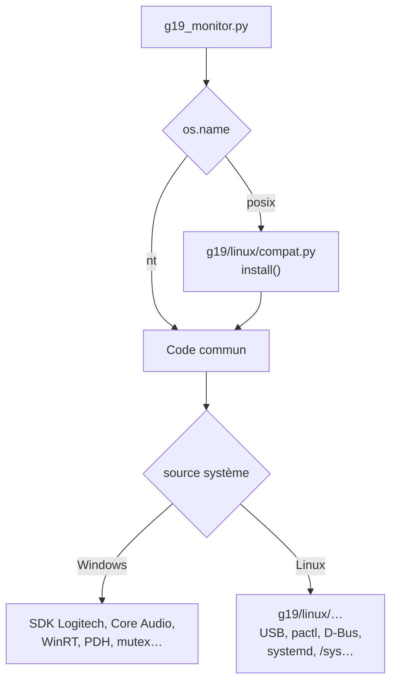

`compat.install()` :

| Remplacé | Par |
|---|---|
| `ctypes.WinDLL`, `OleDLL`, `windll`, `oledll` | une fausse DLL : chaque fonction accepte `argtypes` / `restype`, et **lève `OSError`** à l'appel |
| `ctypes.WINFUNCTYPE`, `WinError`, `get_last_error`, `FormatError` | équivalents inoffensifs |
| module `winreg` | faux module : constantes `HKEY_*`, `KEY_*`, `REG_*`, chaque fonction lève `OSError` |
| `subprocess.CREATE_NO_WINDOW`, `DETACHED_PROCESS`, `CREATE_NEW_PROCESS_GROUP`… | `0` (Python accepte `creationflags=0` hors Windows) |
| `msvcrt`, `_winapi` | **pas** de faux module : Python 3.14 s'en sert pour savoir s'il est sous Windows (`subprocess`) |

Les modules Windows se chargent donc tels quels ; le code attrape déjà `OSError` là où une source
peut manquer. Là où une source Linux existe, l'appli la choisit :

```python
volume = VolumeMonitor() if os.name == "nt" else PulseVolume()
```

### Qui remplace quoi

| Fonction | Windows | Linux |
|---|---|---|
| Écran et touches | SDK LCD de LGS | USB direct — `g19/usb_lcd.py` |
| Rétroéclairage | SDK LED de LGS | `/dev/hidraw`, rapport n° 7 — `g19/linux/g19led.py` |
| Instance unique, arrêt | mutex / événements nommés | `flock` + fichier-signal — `linux/instance.py` |
| Gardien, démarrage | `guard.py`, dossier Démarrage | service utilisateur systemd — `linux/service.py` |
| Capteurs, GPU | LHM, Afterburner, PDH | psutil, `/sys/class/hwmon`, `/sys/class/drm` — `linux/sensors.py` |
| Jeux, FPS | RTSS, ADLX | `SteamAppId` des processus, sans FPS — `linux/games.py` |
| Musique | WinRT SMTC | MPRIS — `linux/mpris.py` |
| Son | Core Audio (pycaw) | `pactl` — `linux/pulse.py` |
| Notifications | UserNotificationListener | `busctl monitor` — `linux/dbusnotify.py` |
| Ne pas déranger | WNF + FocusSession | `Inhibited` / `Inhibit` — `linux/dnd.py` |
| Écran de repos | `GetLastInputInfo`, bureau Winlogon | ScreenSaver, logind — `linux/session.py` |
| Recopie d'écran | GDI `StretchBlt` | portail + PipeWire + GStreamer — `linux/screencast.py` |
| Discord | `\\.\pipe\discord-ipc-N` | socket Unix `discord-ipc-N` — `discord.py` |
| Steam | registre, `Program Files` | `~/.local/share/Steam`, `registry.vdf` — `steam.py`, `steam_live.py` |
| Batteries | PowerShell (PnP) | `/sys/class/power_supply` — `battery.py` |
| Ping | `IcmpSendEcho` | socket ICMP « datagramme » — `netping.py` |
| Polices, icônes | Segoe UI, Fluent Icons, Segoe Emoji | Noto, DejaVu, Unicode, Noto Color Emoji — `linux/fonts.py`, `textfx.py` |
| Fond d'écran | `SystemParametersInfo` | config de Plasma, `gsettings` — `wallpaper.py` |
| Mémoire partagée | mapping nommé (`tagname`) | fichier `/dev/shm/<nom>-<uid>` — `remote.py` |
| Icône | pystray (Win32) | pystray, moteur AppIndicator — `tray.py` |
| Périphériques branchés | `WM_DEVICECHANGE` | — (événements de sortie audio seulement) |
| Ventilateurs | pilotage LHM | lecture seule |

---

## 3. L'écran du G19 en USB direct

Sans LGS, l'appli parle au clavier par libusb (pyusb), dans `g19/usb_lcd.py`.

### L'appareil

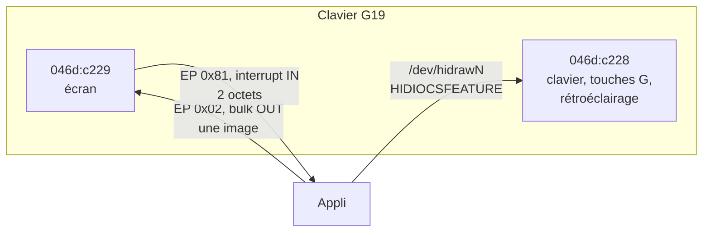

`lsusb -v -d 046d:c229` :

| Interface | Classe | Points d'accès | Pilote noyau |
|---|---|---|---|
| 0 | 255 (vendeur) | `0x81` interrupt IN 2 o · `0x02` bulk OUT 512 o | aucun |
| 1 | 3 (HID) | `0x83` interrupt IN 7 o (touches G) | `usbhid` |

L'appli réclame l'interface 0 (`usb.util.claim_interface`) ; l'interface 1 reste au noyau.

### Une image

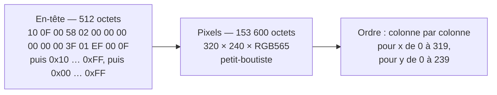

Conversion (`frame_bytes`, numpy) :

```python
px = ((r >> 3) << 11) | ((g >> 2) << 5) | (b >> 3)     # RGB565
data = HEADER + px.T.astype("<u2").tobytes()            # transposée : colonne par colonne
dev.write(0x02, data, timeout=1000)                      # 154 112 octets
```

Une image identique à la précédente n'est pas renvoyée.

### Les touches

L'entrée `0x81` envoie 2 octets à chaque changement ; le second vaut toujours `0x80`.

| Bit | `0x02` | `0x04` | `0x08` | `0x10` | `0x20` | `0x40` | `0x80` |
|---|---|---|---|---|---|---|---|
| Touche | Annuler | Menu | OK | ► | ◄ | ▼ | ▲ |

(`0x01` est aussi lu comme Menu.) Lecture avec un délai de 10 ms ; l'appli ne garde que les
fronts.

### Le fil d'envoi

Comme sous Windows, `LcdThread` envoie l'image et lit les touches : tous les accès USB passent
par ce fil. Mesuré : **59,3 images/s** (1 778 images en 30 s).

### Droits d'accès

`installer/linux/99-g19.rules` :

```text
SUBSYSTEM=="usb", ATTR{idVendor}=="046d", ATTR{idProduct}=="c229", MODE="0666", TAG+="uaccess"
SUBSYSTEM=="usb", ATTR{idVendor}=="046d", ATTR{idProduct}=="c228", MODE="0666", TAG+="uaccess"
KERNEL=="hidraw*", ATTRS{idVendor}=="046d", ATTRS{idProduct}=="c228", MODE="0666", TAG+="uaccess"
KERNEL=="hidraw*", ATTRS{idVendor}=="046d", ATTRS{idProduct}=="c229", MODE="0666", TAG+="uaccess"
```

Sans elle, `claim_interface` échoue (`errno 13`) et l'appli le dit (« installer la règle udev »).

---

## 4. Rétroéclairage (hidraw)

`backlight.py` est le même que sous Windows ; sous Linux, son « SDK » est `G19Led`
(`g19/linux/g19led.py`), qui imite les fonctions de `LogitechLed.dll` :

| Fonction imitée | Sous Linux |
|---|---|
| `LogiLedInit` | ouvre le `/dev/hidrawN` de `046d:c228` **interface 1** (trouvé dans `/sys/class/hidraw/*/device`) |
| `LogiLedSetLighting(r, g, b)` | rapport *feature* `[7, R, G, B]` (0–255) par `ioctl(HIDIOCSFEATURE(4))` |
| `LogiLedFlashLighting`, `LogiLedPulseLighting` | un fil anime la couleur toutes les 30 ms (créneau, ou cosinus 15–100 %) |
| `LogiLedSaveCurrentLighting` / `RestoreLighting` | le clavier ne dit pas sa couleur (lecture refusée) : retour au blanc |

`HIDIOCSFEATURE(n) = (3 << 30) | (n << 16) | (ord('H') << 8) | 6`. Les mêmes états que sous
Windows (alerte, Claude attend / travaille / a fini, messages…) colorent le clavier.

---

## 5. Fluidité : le cache des textes

Avec Noto Sans, FreeType exécute le programme de *hinting* de chaque lettre à chaque dessin :
**2,6 ms** par court libellé (DejaVu Sans : 0,4 ms ; même ordre avec `raqm` ou le moteur
simple). Une page en a une vingtaine.

`g19/textcache.py` remplace `FreeTypeFont.getmask2` (ce qu'appelle `ImageDraw.text`) par une
version qui garde le résultat :

```text
clé    = (police, texte, mode, direction, features, langue, contour, ancre, encre,
          position sous-pixel arrondie au ¼ de pixel, autres options)
valeur = (masque, décalage)          — 6 000 entrées au plus, vidé d'un coup au-delà
```

```mermaid
xychart-beta
    title "Coût sur i5-8265U (ms) — barre 1 : avant, barre 2 : avec le cache"
    x-axis ["Page Système", "Page GPU", "Image complète"]
    y-axis "ms" 0 --> 28
    bar [22.4, 26.2, 15.0]
    bar [1.7, 4.1, 3.5]
```

Budget à 60 i/s : 16,7 ms. Image complète après : rendu 1,3 ms, retouches 0,2, tramage 1,7,
conversion USB 0,4.

### Pillow 12

Deux changements de Pillow 12 (le Windows est en 11.3) ont dû être couverts :

| Changement | Effet | Correction |
|---|---|---|
| `ImageDraw.line(width=0)` ne trace plus rien (défaut passé à 1) | barre chromée du thème G19, liserés, séparateurs invisibles | `SmoothDraw.line` : épaisseur 0 → 1 |
| signature de `getmask2` : options passées par `**kwargs` (`stroke_filled`) | — | le cache les met dans sa clé |

---

## 6. Capteurs, GPU et jeux

`LinuxGpu` (`g19/linux/sensors.py`) a la même interface que `gpu.GpuMonitor` (`s`, `game`,
`fps_hist`, `load_hist`, `sample()`, `sample_fps()`…).

| Mesure | Source | Exemple |
|---|---|---|
| Température CPU | `psutil.sensors_temperatures()` : `coretemp` « Package id 0 », `k10temp` « Tctl »/« Tdie », `zenpower`, `acpitz` | 61 °C |
| Fréquence CPU | `psutil.cpu_freq()` | 3,4 GHz |
| Ventilateur | `psutil.sensors_fans()` (ici `thinkpad`) | 1 927 tr/min |
| Charge GPU AMD | `/sys/class/drm/card*/device/gpu_busy_percent` | — |
| VRAM AMD | `…/mem_info_vram_used` | — |
| Température GPU AMD | `amdgpu` : `edge`, `junction`, `mem` | — |
| **Charge GPU Intel** | `/sys/class/drm/card*/gt/gt0/rc6_residency_ms` | 6,8 % |
| Fréquence GPU Intel | `…/gt0/rps_act_freq_mhz` | 300 MHz |
| Nom du GPU | `lspci -mm` (« WhiskeyLake-U GT2 [UHD Graphics 620] » → « UHD Graphics 620 ») | |
| Nom du CPU | `/proc/cpuinfo`, « model name » | Core i5-8265U |

Le pilote i915 ne publie pas de charge ; elle se déduit du temps passé en veille profonde (RC6)
entre deux lectures :

```text
charge = 100 × (1 − Δ rc6_residency_ms / Δ t_ms)
```

### Jeux

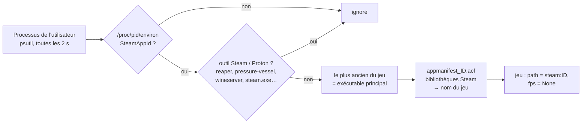

Le chemin `steam:ID` fait reconnaître le jeu par `catalog.identify` (lanceur Steam, `appid`) :
sessions, page GPU au lancement, succès Steam et récapitulatif fonctionnent. Pas de FPS : il
n'existe pas d'équivalent universel de RTSS sous Linux.

---

## 7. Son (PipeWire / PulseAudio)

`PulseVolume` (`g19/linux/pulse.py`) a l'interface de `volume.VolumeMonitor`. Tout passe par
`pactl` (PipeWire-pulse ou PulseAudio) :

| Lecture | Commande |
|---|---|
| sorties, entrées | `pactl --format=json list sinks` / `list sources` (sans les `.monitor`) |
| par défaut | `pactl get-default-sink` / `get-default-source` |
| applis | `pactl --format=json list sink-inputs`, regroupées par `application.name` |
| changements | `pactl subscribe` (processus permanent) : toute ligne `'change'`, `'new'`, `'remove'` relance une lecture (au plus toutes les 30 ms) ; sinon toutes les 2 s |

| Commande `do()` | `pactl` |
|---|---|
| `("master", ±pas)` | `set-sink-volume @DEFAULT_SINK@ N%` (+ `set-sink-mute … 0` si on monte) |
| `("master_mute",)` | `set-sink-mute @DEFAULT_SINK@ toggle` |
| `("mic", …)`, `("mic_mute",)` | idem sur `@DEFAULT_SOURCE@` |
| `("app", nom, ±pas)`, `("app_mute", nom)` | `set-sink-input-volume` / `-mute` sur chaque flux de l'appli |
| `("default", id)` | `set-default-sink` (ou `-source`) **+ `set-sink-port`** |
| `("profile", p)` | `apply_profile` |

### Ports : casque et haut-parleurs sur la même carte

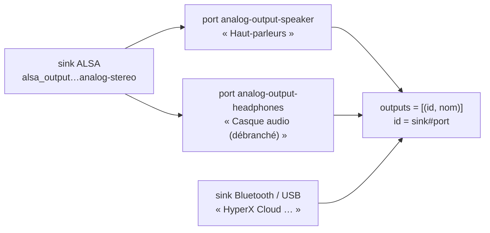

Une sortie à **plusieurs ports** donne une ligne par port, d'identifiant `sink#port` ; la ligne
active est celle dont le port est `active_port`. Un port `availability = not available` porte
« (débranché) ». Choisir une ligne : `set-default-sink sink` puis `set-sink-port sink port`.

### Profils et bascule

- Profils copiés de Windows : **gardés seulement si tous** trouvent leur sortie ; sinon profils
  automatiques « Casque » / « Haut-parleurs » (mots-clés des noms de ports). Un port
  « (débranché) » est classé en dernier et jamais visé par la bascule automatique.
- La bascule automatique (`mixer.auto_switch`) est la même que sous Windows : sortie de type
  casque apparue, ou HyperX allumé → profil Casque ; l'inverse → Haut-parleurs.
- `pactl subscribe` est lancé avec `PR_SET_PDEATHSIG` (`prctl(1, SIGTERM)`) : il meurt avec
  l'appli au lieu de rester orphelin à chaque relance.

---

## 8. Musique (MPRIS)

`MprisMonitor` (`g19/linux/mpris.py`), interface de `media.MediaMonitor`, lit le bus de session
toutes les 0,5 s :

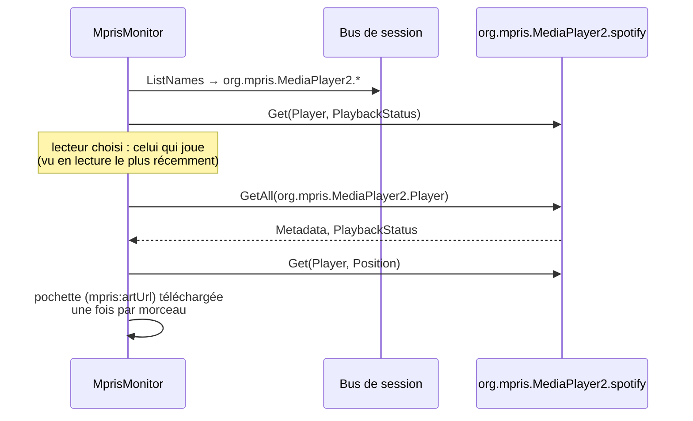

| MediaState | MPRIS |
|---|---|
| `title`, `artist`, `album` | `xesam:title`, `xesam:artist` (liste jointe par « , »), `xesam:album` |
| `duration`, `position` | `mpris:length`, `Position` (µs) |
| `playing` | `PlaybackStatus == "Playing"` |
| pochette | `mpris:artUrl` : `file://…` ou `https://…` (Spotify) |
| `app` | nom du bus (`spotify`, `firefox`, `chromium`, `vlc`, `mpv`…) ou `Identity` |

Commandes : `PlayPause`, `Next`, `Previous` sur `org.mpris.MediaPlayer2.Player`.

---

## 9. Notifications, Ne pas déranger, repos

### Notifications

`LinuxNotifications` (`linux/dbusnotify.py`) lance :

```bash
busctl --user monitor --json=short \
  --match type=method_call,interface=org.freedesktop.Notifications,member=Notify
```

Chaque ligne est un message JSON ; la charge `"type": "susssasa{sv}i"` donne, dans l'ordre :
appli, id remplacé, icône, **titre**, **texte**, actions, indices, durée. Le HTML (KDE, GNOME)
est retiré. L'appli **observe** sans intercepter : la notification s'affiche comme d'habitude
dans le bureau. Processus séparé, pas de boucle GLib : celle de l'icône (GTK) n'est pas gênée.

### Ne pas déranger

`LinuxDnd` (`linux/dnd.py`), sur `org.freedesktop.Notifications` :

| Lecture | Action depuis le G19 |
|---|---|
| propriété `Inhibited` (vrai si une inhibition existe) | `Inhibit("g19-monitor", "Ne pas déranger (G19)", {})` → jeton |
| `~/.config/plasmanotifyrc`, `[DoNotDisturb] Until=` encore à venir | `UnInhibit(jeton)` au second appui |

L'inhibition est liée à la connexion D-Bus de l'appli : elle tombe si l'appli s'arrête. Activé
depuis Plasma, il se voit sur le G19 mais se coupe depuis Plasma.

### Écran de repos

`linux/session.py` fournit les trois fonctions qu'`away.py` utilise sous Windows :

| Fonction | Linux |
|---|---|
| `is_locked()` | `org.freedesktop.ScreenSaver.GetActive` (KWin), sinon `LockedHint` de logind |
| `idle_seconds()` | `IdleHint` / `IdleSinceHint` de la session logind (bus système) |
| `display_required()` | `org.freedesktop.PowerManagement.Inhibit.HasInhibit` |

Sous Wayland, `GetSessionIdleTime` n'est pas fourni aux applis : l'écran de repos se déclenche
sur verrouillage ou session déclarée inactive, pas après « 5 min sans toucher ».

---

## 10. Recopie d'écran (Wayland)

`LinuxMirror` (`linux/screencast.py`) : portail **ScreenCast** de xdg-desktop-portal, flux
**PipeWire**, lu par **GStreamer**.

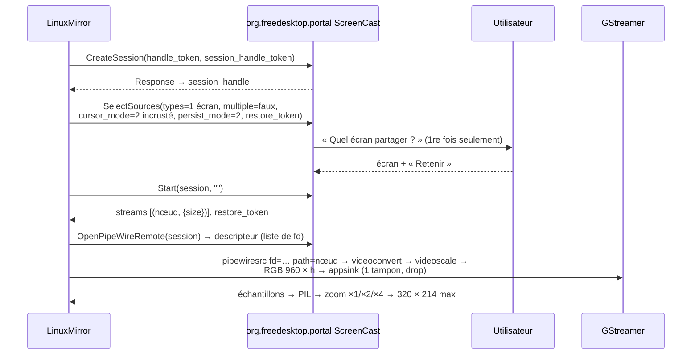

Détails :

- Chaque appel du portail répond par un **signal** `Request.Response` sur un chemin construit à
  partir du nom unique du client et du `handle_token`. Le fil a **son propre contexte GLib**
  (`MainContext.push_thread_default`) : il n'entre pas en conflit avec la boucle GTK de l'icône.
- Pipeline exact :

  ```text
  pipewiresrc fd=FD path=NŒUD always-copy=true do-timestamp=true ! videoconvert ! videoscale !
  video/x-raw,format=RGB,width=960,height=H,pixel-aspect-ratio=1/1 !
  appsink name=sink max-buffers=1 drop=true sync=false
  ```

  `H` est calculé à partir de la taille de l'écran (`size` du flux) : laissée libre, la hauteur
  était négociée à 1 pixel.
- Le `restore_token` est gardé dans `screencast.json` : la capture reprend sans rien demander.
  OK sur la page l'efface et redemande quel écran partager.
- Page quittée depuis plus de 5 s : pipeline en pause ; reprise dès que la page revient.
- Mesuré : 320 × 180 (écran 1920 × 1080), ~16 images/s sur l'i5.

---

## 11. Discord et Steam

### Discord

`Pipe` (`discord.py`) se connecte en socket Unix (`AF_UNIX`, flux) au premier
`discord-ipc-0…9` trouvé dans :

```text
$XDG_RUNTIME_DIR/
$XDG_RUNTIME_DIR/app/com.discordapp.Discord/        (Flatpak)
$XDG_RUNTIME_DIR/snap.discord/                      (Snap)
$XDG_RUNTIME_DIR/.flatpak/com.discordapp.Discord/xdg-run/
/tmp/
```

Lecture non bloquante : `ioctl(FIONREAD)` donne les octets en attente (au lieu de
`PeekNamedPipe`) ; un socket lisible mais vide signale une connexion fermée. Le protocole
(trames `<II` op + longueur, puis JSON) et l'autorisation (`discord.json`, copié de Windows)
sont les mêmes. Clients reconnus : `discord`, `discordptb`, `discordcanary`, `vesktop`, `webcord`.

### Steam

| Besoin | Linux |
|---|---|
| dossier de Steam | `~/.local/share/Steam`, `~/.steam/steam`, Flatpak `~/.var/app/com.valvesoftware.Steam/…` (le premier qui a `steamapps/`) |
| bibliothèques | `steamapps/libraryfolders.vdf` |
| « registre » de Steam | `~/.steam/registry.vdf` (clés `Registry/HKCU/Software/Valve/Steam/…`) |
| Steam lancé ? | processus nommé `steam` (le Steam récent n'écrit plus `ActiveProcess`) |
| amis, succès | Steam Web API, comme sous Windows (`steam_api.json`) |

---

## 12. Polices, icônes, émojis

### Polices

`linux/fonts.py` traduit chaque police demandée par le code commun, via `fc-match` (le résultat
n'est retenu que si la famille obtenue est bien celle demandée) :

| Windows | Linux |
|---|---|
| `segoeui.ttf` / `segoeuib.ttf` | Noto Sans / Noto Sans Bold |
| `tahoma`, `trebuc` | DejaVu Sans |
| `times` | Liberation Serif |
| `framd` (Cadrans) | DejaVu Sans Condensed Bold |
| `CascadiaMono` (HUD) | DejaVu Sans Mono (police fixe : la graisse variable est ignorée) |
| `seguisym` | DejaVu Sans |
| `seguiemj` | Noto Color Emoji |
| `YuGothM`, `msyh`, `msjh`, `malgun` | Noto Sans CJK JP / SC / TC / KR |
| `Nirmala`, `LeelawUI`, `ebrima`, `seguihis`, `cambria` | Noto Sans Devanagari / Thai / Ethiopic / Runic / Math |

### Icônes

Les 26 icônes Segoe (codes privés `U+E700…`) sont remplacées par des symboles Unicode (▦ ⌂ ☼
⏻ ✦ ▶ ❋ 🕭 ✉ ⟲ ▭ ▣ ☺ ▮ ⛽ ◈ ☾ ◀ ✕ ● ♪ ⌨ ☁ ⚙…). Pour chaque icône, une liste de candidats
est essayée dans DejaVu Sans, Noto Sans Symbols 2, Noto Sans Symbols puis Noto Sans ; un
caractère est jugé présent si son dessin diffère du carré « caractère absent » de la police
(test par Pillow, sans fontTools). L'utilitaire (Qt) utilise la même table.

### Émojis

Noto Color Emoji n'existe qu'en **une taille** (images couleur de 109 px). `textfx.py` dessine
chaque émoji à 109 px (`embedded_color=True`), le recadre, le réduit à la taille du texte
(× 0,95) et le pose sur la ligne de base ; résultat gardé en cache (2 048 entrées).

---

## 13. Instance unique et relance

`linux/instance.py` remplace les mutex et événements nommés. Fichiers dans
`$XDG_RUNTIME_DIR/g19-monitor/` (sinon `/tmp/g19-monitor/`), nommés d'après le mutex Windows :

| Fichier | Rôle |
|---|---|
| `G19PCMonitor.lock` | verrou `flock` exclusif et non bloquant (`LOCK_EX`, `LOCK_NB`) tenu par l'instance ; contient son PID. Libéré par le noyau si l'appli plante. |
| `G19PCMonitorQuit.quit` | demande d'arrêt (`--stop`) ; aussi `SIGTERM` / `SIGINT` |
| `G19PCMonitorGuardStop.stopped` | « quittée exprès » |

`is_running()` tente le verrou sans l'attendre. `wait_exit(pid)` sonde `os.kill(pid, 0)`.

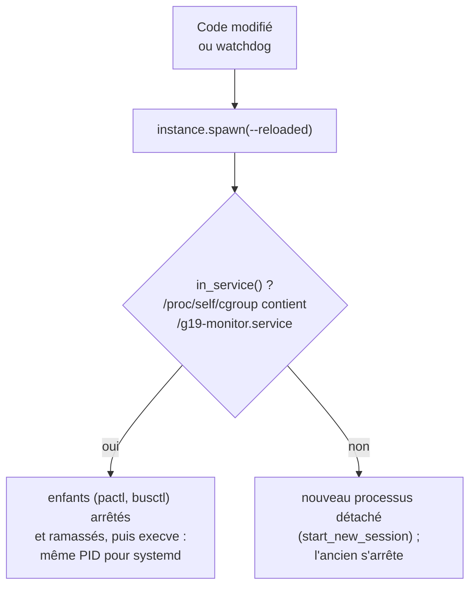

`INVOCATION_ID` ne suffit pas à reconnaître le service : Plasma lance terminal et applis sous
systemd, elles en héritent. Le test se fait donc sur le *cgroup*.

---

## 14. Le gardien (systemd)

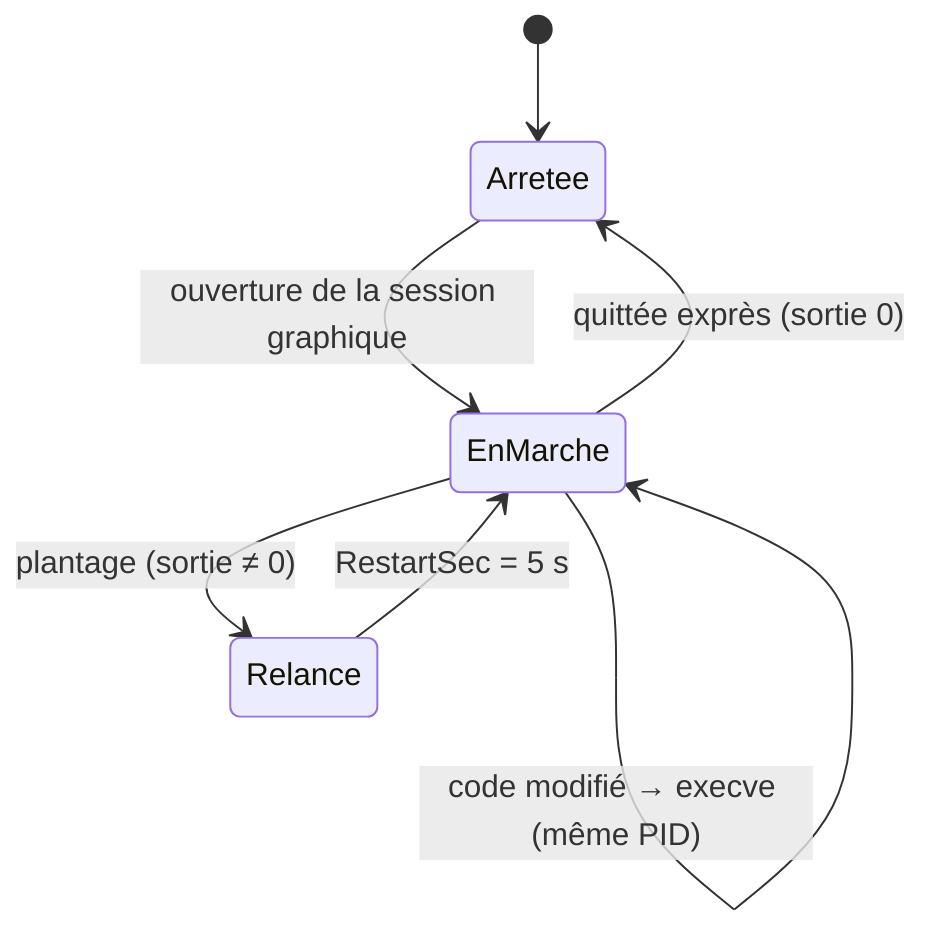

`~/.config/systemd/user/g19-monitor.service`, écrit par `linux/service.py` :

```ini
[Unit]
Description=G19 Monitor (écran du Logitech G19)
After=graphical-session.target pipewire.service
PartOf=graphical-session.target

[Service]
ExecStart=/usr/sbin/python /home/…/g19-monitor/g19_monitor.py
WorkingDirectory=/home/…/g19-monitor
Restart=on-failure
RestartSec=5
Environment=PYTHONUNBUFFERED=1

[Install]
WantedBy=graphical-session.target
```

Activation : icône → « Démarrage auto et gardien », ou utilitaire → Système → *Démarrage avec la
session* (`systemctl --user enable` / `disable`, après `daemon-reload`). Le service ne démarre ni
n'arrête l'appli en cours.

---

## 15. Icône et utilitaire

| Élément | Linux |
|---|---|
| Moteur de l'icône | `PYSTRAY_BACKEND=appindicator` forcé : l'icône StatusNotifier (Ayatana), seule affichée par Plasma / GNOME sous Wayland ; l'icône X11 de pystray y serait invisible |
| Boucle GTK | `icon.run()` dans un fil (`run_detached` ne lance pas la boucle GTK) |
| Menu « Gardien… » | devient la case « Démarrage auto et gardien » (service systemd) |
| Journal, dossiers | `xdg-open` au lieu de `os.startfile` |
| Utilitaire | charge la couche de compatibilité ; Tk et pystray facultatifs (le dessin de l'icône reste disponible) |
| Rubrique Système | ventilateurs (LHM) masqués, réglages gardés ; gardien = interrupteur systemd |
| Rubrique Audio | périphériques Linux par port (`list_devices`), profils appliqués par `pactl` |
| Aperçu en direct | mémoire partagée `/dev/shm/G19MonitorMirror-<uid>` et `…Stats-<uid>` (mêmes formats que sous Windows) |

L'icône est d'abord rangée par Plasma dans les icônes masquées (flèche ˄ de la barre) :
« Configurer… → Entrées → G19 Monitor → Toujours afficher ».

---

## 16. Fichiers

| Emplacement | Contenu |
|---|---|
| `~/.config/g19-monitor/` | réglages et données (mêmes noms que `%LOCALAPPDATA%\G19Monitor` sous Windows), plus `screencast.json` (jeton du portail) |
| `$XDG_RUNTIME_DIR/g19-monitor/` | verrous et fichiers-signaux d'instance |
| `/dev/shm/G19Monitor*-<uid>` | aperçu en direct et fluidité pour l'utilitaire |
| `~/.config/systemd/user/g19-monitor.service` | service du gardien |
| `/etc/udev/rules.d/99-g19.rules` | droits d'accès au G19 |
| `g19.log` (dossier de l'appli) | journal |

Accès personnels (Discord, Steam, Home Assistant, agenda) : copier les fichiers de
`%LOCALAPPDATA%\G19Monitor` dans `~/.config/g19-monitor/`.

---

## 17. Limites

| Sujet | État |
|---|---|
| FPS des jeux | non (pas d'équivalent de RTSS) ; le jeu est détecté |
| Écran de repos | verrouillage ou session inactive seulement (Wayland) |
| Ne pas déranger activé depuis Plasma | visible ; se coupe depuis Plasma |
| Icônes | symboles Unicode à la place des icônes Segoe |
| Ventilateurs | lecture seule |
| Branchement de périphériques | pas de bandeau (sauf sorties audio) |
| Couleur du clavier au repos | blanc (le clavier ne dit pas sa couleur) |
| G15 Monitor | pas encore porté |

---

## 18. Développer sur la branche Linux

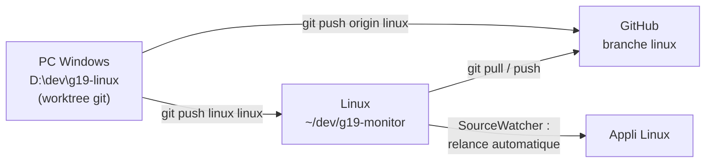

- La copie Linux accepte les envois directs (`git config receive.denyCurrentBranch
  updateInstead`) : un `git push` met ses fichiers à jour, l'appli se relance.
- Sa branche suit `origin/linux` : les mises à jour automatiques viennent de la branche Linux.
- Outils :

| Script | Rôle |
|---|---|
| `tools/linux_lcd_test.py` | mire, couleurs, sens de l'image, codes des touches, fluidité |
| `tools/linux_dry_run.py [s]` | la vraie boucle pendant *s* secondes avec un faux écran |
| `tools/linux_bench.py` | coût d'une image avec tes réglages (rendu, retouches, tramage, USB) |
| `tools/linux_profile.py` | coût par page, variantes, profil cProfile |
| `python3 g19_monitor.py --preview DOSSIER` | toutes les pages en PNG, sans le G19 |
