# G19 Monitor sous Windows — fonctionnement technique

Ce document décrit l'appli de l'intérieur : les programmes, la boucle d'affichage, chaque source
de données, le rendu, les touches, les formats de fichiers et de mémoire partagée, les durées et
les seuils. Les valeurs citées sont celles du code (branche `main`).

Pour l'installation et la liste des pages, voir le [README](../README.md). La version Linux est
décrite dans [FONCTIONNEMENT_LINUX.md](FONCTIONNEMENT_LINUX.md).

**Sommaire** — [1. Programmes](#1-les-programmes) · [2. Code](#2-le-code-module-par-module) ·
[3. Démarrage](#3-le-démarrage) · [4. Boucle](#4-la-boucle-principale) ·
[5. Sources](#5-les-sources-de-données) · [6. Rendu](#6-le-rendu-dune-image) ·
[7. Écran et touches](#7-écran-touches-et-rétroéclairage) · [8. Navigation](#8-navigation) ·
[9. Bandeaux](#9-bandeaux-et-ne-pas-déranger) · [10. Audio](#10-audio) ·
[11. Ventilateurs](#11-ventilateurs) · [12. Claude](#12-le-voyant-claude) ·
[13. Gardien](#13-instances-gardien-relances) · [14. Mises à jour](#14-mises-à-jour) ·
[15. Utilitaire](#15-utilitaire--appli) · [16. Fichiers](#16-fichiers-de-données) ·
[17. Dépannage](#17-dépannage)

---

## 1. Les programmes

Cinq programmes, chacun dans son processus. Ils communiquent par des fichiers, de la mémoire
partagée et des objets nommés de Windows (mutex, événements) — jamais par le réseau.

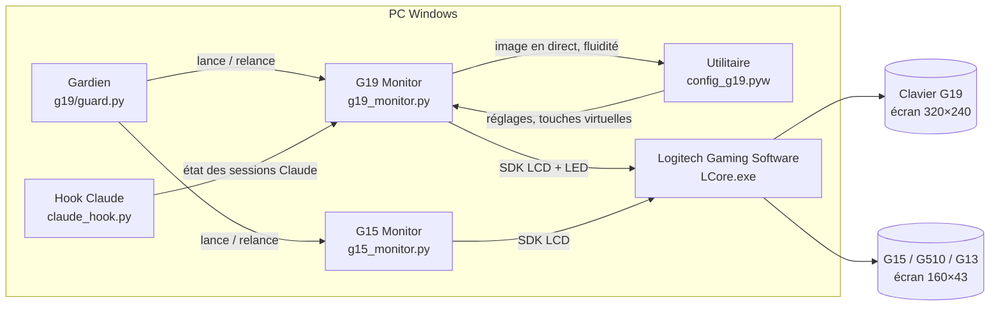

| Programme | Rôle | Démarré par | Instance unique |
|---|---|---|---|
| **G19 Monitor** `g19_monitor.py` | capteurs, services, rendu, écran, touches, rétroéclairage, ventilateurs | le gardien, `start_g19.pyw` | mutex `Local\G19PCMonitor` |
| **Gardien** `g19/guard.py` | lance l'appli du clavier branché, la relance si elle disparaît | démarrage de Windows (`start_guard.pyw`) | mutex `Local\G19PCMonitorGuard` |
| **Utilitaire** `config_g19.pyw` | réglages (Qt / PySide6), aperçu en direct, clavier virtuel | l'icône, le menu Démarrer | — |
| **G15 Monitor** `g15_monitor.py` | version 1 bit pour G15 / G510 / G13, à côté de G19 Monitor | le gardien | mutex `Local\G15PCMonitor` |
| **Hook Claude** `claude_hook.py` | écrit l'état de chaque session Claude Code | Claude Code, à chaque événement | — (un fichier par session) |

---

## 2. Le code, module par module

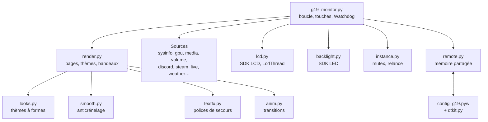

| Domaine | Modules |
|---|---|
| Boucle, démarrage | `g19_monitor.py` (`run`, `LoopClock`, `Splash`, `Watchdog`, `guarded`) |
| Rendu | `render.py` (5 000 lignes : `Ctx`, pages, en-tête, bandeaux), `looks.py`, `smooth.py`, `textfx.py`, `anim.py`, `coverflow.py`, `menu.py`, `screen.py`, `night.py` |
| Matériel | `lcd.py`, `backlight.py`, `fans.py`, `lhm.py`, `afterburner.py`, `rtss.py`, `adlx.py`, `gpu.py`, `sysinfo.py`, `headset.py`, `keyboards.py` |
| Audio, média | `volume.py`, `mixer.py`, `media.py`, `lyrics.py` |
| Services | `discord.py`, `discord_panel.py`, `steam.py`, `steam_live.py`, `achievements.py`, `catalog.py`, `covers.py`, `games.py`, `weather.py`, `agenda.py`, `home.py`, `fuel.py`, `speedtest.py`, `netping.py`, `vpn.py`, `docker_mon.py`, `git_status.py`, `streaming.py`, `amd_driver.py` |
| Windows | `notifications.py`, `dnd.py`, `away.py`, `devices.py`, `battery.py`, `screencap.py`, `wallpaper.py`, `focus.py`, `sysalerts.py` |
| Claude | `claude_status.py`, `claude_usage.py`, `claude_hook.py`, `install_hooks.py` |
| Suivi | `alerts.py`, `history.py`, `daily.py`, `away.py` |
| Plomberie | `config.py`, `settings.py`, `instance.py`, `remote.py`, `updater.py`, `version.py`, `guard.py`, `tray.py`, `launcher.py`, `backup.py` |

---

## 3. Le démarrage

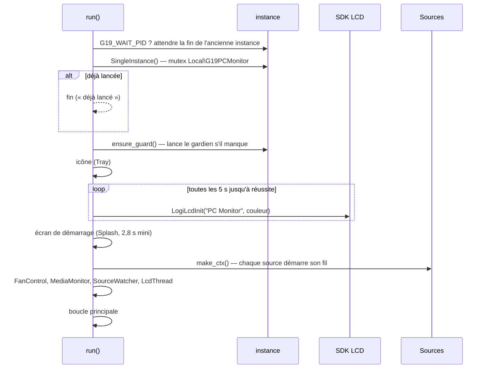

`make_ctx()` construit le **contexte** `Ctx` (dataclass de `render.py`) : une référence vers
chaque source (`stats`, `gpu`, `volume`, `discord`, `weather`…) et l'état d'affichage partagé
(curseurs, page Bilan, bandeau fermé…). Les pages ne lisent que lui.

---

## 4. La boucle principale

### Ce qui tourne à chaque tour, et à quel rythme

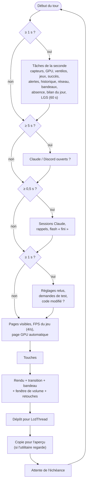

| Rythme | Travail |
|---|---|
| chaque image | touches, rendu, envoi ; FPS du jeu toutes les 0,25 s |
| 0,5 s | sessions Claude (`read_sessions`), rappels, rétroéclairage « fini » |
| 1 s | capteurs (`stats.sample` ≈ 10 ms), GPU, ventilateurs, jeux, alertes, historique, ping, bandeaux, absence, bilan, réglages, code source |
| 5 s | Claude et Discord lancés ? (liste des processus) |
| 60 s | LGS autorise-t-il le contrôle de l'éclairage ? |

### Rythme par échéances

```text
step      = 1 / fps   (ou 1/60 quand l'utilitaire affiche le direct)
next_tick = next_tick + step
si retard > step : next_tick = maintenant          (on repart, sans rafale)
attente   = next_tick − maintenant                 (Event.wait, réveillé par un changement de volume)
```

Un minuteur Windows qui déborde d'une milliseconde est rattrapé au tour suivant : la fluidité
réelle colle au réglage (55,0 i/s pour 55, contre 52,5 avant).

### Fil d'envoi `LcdThread`

La boucle dépose la dernière image ; le fil l'envoie (`LogiLcdColorSetBackground` +
`LogiLcdUpdate`, 4 à 30 ms) puis lit les touches (`LogiLcdIsButtonPressed`). Une image arrivée
avant que la précédente soit partie la remplace. **Tous** les appels au SDK passent par ce fil.
Sans image, il relit les touches toutes les 10 ms.

### Garde-fous

- `guarded(nom, fn, …)` : chaque tâche est appelée à travers lui ; une exception est notée dans
  `g19.log` (une fois par 5 min et par tâche), la durée la plus longue de chaque tâche est gardée
  pour le résumé `boucle :`.
- **Watchdog** : la boucle signale qu'elle vit à chaque tour ; figée depuis **45 s**, le chien
  écrit la pile de tous les fils dans `g19.log` (`faulthandler`), rend les ventilateurs à
  l'auto et lance une instance neuve (`--reloaded`, qui attend la fin de celle-ci).
- `LoopClock` : temps par étape (attente, tâches, touches, rendu, retouches, envoi, aperçu),
  résumé toutes les 10 min dans le journal.

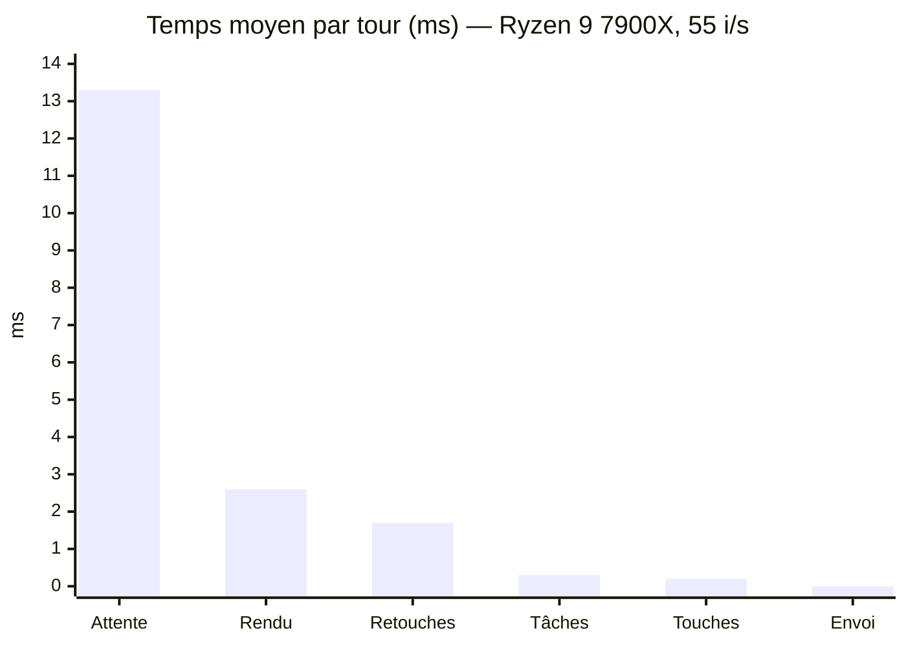

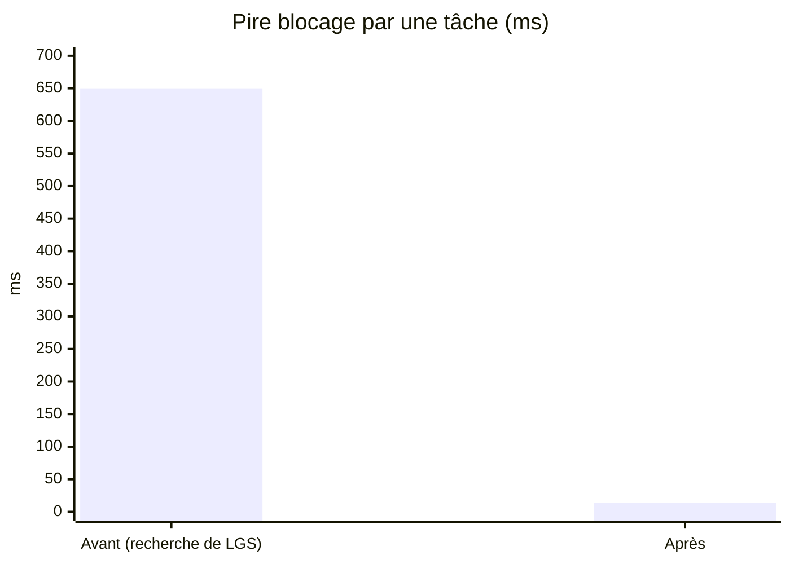

La recherche de LCore.exe demandait l'heure de lancement de **tous** les processus
(`process_iter(["create_time"])`, 1,3 s) ; elle ne la demande plus qu'à LCore.exe (0,9 ms).

---

## 5. Les sources de données

Chaque source a son fil et son rythme ; la boucle ne lit que leurs derniers résultats.

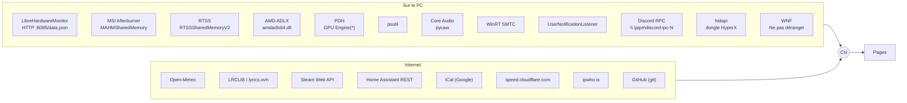

### Matériel et système

| Source | Accès | Détails |
|---|---|---|
| CPU, RAM, disques, réseau | `psutil` | toutes les secondes ; occupation des disques toutes les 30 s |
| Charge et VRAM du GPU | compteurs **PDH** `\GPU Engine(*)\Utilization Percentage`, `\GPU Adapter Memory(*)\Dedicated Usage` | les mêmes que le Gestionnaire des tâches (AMD, NVIDIA, Intel) ; nom et VRAM totale lus dans le registre |
| Capteurs GPU | **Afterburner** : mémoire partagée `MAHMSharedMemory` (signature `MAHM`, en-tête `<6I`) | température, hotspot, horloges, puissance, ventilateur… |
| Capteurs CPU, carte mère | **LibreHardwareMonitor**, serveur web `http://localhost:8085/data.json` | complète Afterburner ; aussi utilisé pour piloter les ventilateurs |
| FPS et temps d'image | **RTSS** : `RTSSSharedMemoryV2` (signature `RTSS`, entrées `<I260sIIIII>`) | entrée périmée après 1,5 s ; application au premier plan d'abord |
| FPS sans RTSS | **ADLX** (`amdadlx64.dll`), appelée par ses tables virtuelles : `ISystem` → index 9 (`GetPerformanceMonitoringServices`), → index 20 (`GetCurrentFPS`) | utile pour les jeux protégés (CS2 en mode de confiance) ; mesure périmée après 3 s |
| Jeu sans RTSS | fenêtre plein écran au premier plan, exécutable dans un dossier de jeux | FPS `None` |
| Casque HyperX | **hidapi**, rapport de sortie `0x0C` sur l'interface 3 du dongle `03F0:02CC` / `06BE` | batterie, charge, micro coupé, allumé ; relu toutes les 60 s |
| Bluetooth | PowerShell, propriétés PnP (clés `{104EA319…} 2`, `{83DA6326…} 15`) | toutes les 60 s ; bandeau sous 20 %, rappel toutes les 30 min |
| Périphériques branchés | fenêtre invisible qui reçoit `WM_DEVICECHANGE` | anti-rebond 2 s |
| Ping | API ICMP de Windows (`IcmpSendEcho`) | 1 ping/s, 120 mesures gardées, délai 1 s |

### Média et son

| Source | Accès | Détails |
|---|---|---|
| Musique en cours | **WinRT SMTC** (`GlobalSystemMediaTransportControlsSessionManager`) | toutes les secondes ; pochette 112 × 112, fond flouté ; frise gardée et avancée par l'appli quand le navigateur ne la publie pas |
| Paroles | **LRCLIB** `/api/get` puis `/api/search` | 503 / 429 : jusqu'à 4 essais selon `Retry-After` ; échec : **lyrics.ovh** (sans synchro), LRCLIB retenté après 45 s ; bandeau au 2ᵉ échec de suite |
| Volume, micro, applis | **Core Audio** (pycaw), un seul fil COM | événements de volume (`IAudioEndpointVolumeCallback`) : la fenêtre de volume réagit tout de suite ; commandes par `do()` |

### Services en ligne

| Service | Accès | Rythme |
|---|---|---|
| Météo | Open-Meteo (`api.open-meteo.com`), géocodage Open-Meteo / OpenStreetMap | 10 min ; position par IP gardée 6 h ; bandeau de pluie 45 min avant (≥ 0,2 mm) |
| Steam, amis | Steam Web API (`GetPlayerSummaries`, `GetFriendList`…), fichiers locaux de Steam | amis 30 s, liste 10 min ; téléchargements 3 s |
| Succès | `GetSchemaForGame`, `GetPlayerAchievements`, `GetGlobalAchievementPercentagesForApp` | toutes les 30 s pendant une partie |
| Discord | RPC local : poignée de main, `AUTHORIZE` / `AUTHENTICATE` (OAuth, jetons dans `discord.json`), abonnements vocaux et notifications | en continu |
| Agenda | adresse iCal (`icalendar` + `recurring-ical-events`) | 10 min, 7 jours |
| Maison, Carburant | Home Assistant `/api/states`, `/api/services/{domaine}/{service}` | Maison 5 s (60 s hors page), Carburant 5 min |
| Débit | `speed.cloudflare.com` : 12 pings, 4 flux × 8 s, morceaux 50 Mo / 8 Mo | à la demande |
| VPN, IP publique | CLI Tailscale, adaptateurs ; `ipwho.is` | 5 s ; IP 5 min |
| Docker | CLI `docker` | 5 s (30 s hors page) ; boucle de redémarrages : 3 en 5 min |
| Git / PR | `git`, GitHub CLI `gh` | git 15 s, PR 2 min |
| Pilote AMD | catalogue local d'AMD (`%LOCALAPPDATA%\AMD_Common`) | 1 h ; rappel quotidien |
| Streaming entrant | journaux de Sunshine et Parsec (lecture de la fin) | 1 s |

Les clés et jetons (Steam, Home Assistant, Discord, adresses d'agenda) restent dans
`%LOCALAPPDATA%\G19Monitor` ; chacun n'est envoyé qu'à son propre service.

---

## 6. Le rendu d'une image

### Chaîne de rendu

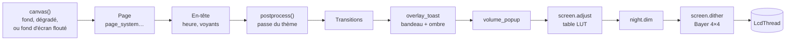

| Étape | Détails |
|---|---|
| **Thèmes** | 20 palettes (`render.py`) ; 9 thèmes changent aussi la forme des éléments (`looks.SHAPED` : Aero, Cadrans, HUD, Tron, Papier, Papier sombre, Pixel, XP, Symbian) ; « dynamique » prend la couleur de la pochette ou du jeu. |
| **Fond d'écran** | `wallpaper.py` (`SystemParametersInfo`), recadré et flouté, relu toutes les 10 s ; cadres et barre rendus translucides (80 % / 88 %). |
| **Formes lissées** | `smooth.SmoothDraw` : ellipse, arc, part, corde, rectangle arrondi, polygone et trait en biais tracés dans un masque **4×** plus grand, réduit (`reduce(4)`), posé dans sa couleur ; jusqu'à 3 000 masques en cache (clé : forme, taille, position au ¼ de pixel). Texte, rectangles droits et traits horizontaux / verticaux passent tels quels. Désactivé pour le thème Pixel. |
| **Polices de secours** | `textfx.py` : émojis (Segoe UI Emoji), symboles (Segoe UI Symbol), CJK, indien, thaï, africain, runes, maths — caractère par caractère, alignés sur la ligne de base. |
| **Transitions** | `anim.Transitions` : glissement, fondu, zoom…, 0,15 / 0,24 / 0,38 s ; la barre du haut (25 px) reste fixe ; réveil après l'écran de repos : 0,5 s. |
| **Bandeau** | entre en 0,35 s, sort en 0,3 s, reste `toast_seconds` (6 s par défaut) ; posé après la transition (il ne glisse pas) ; ombre floue (rayon 4, décalage 3 px). |
| **Défilement** | `marquee()` : texte trop long → pause 2,5 s, 26 px/s, écart 36 px, bords estompés sur 10 px. |
| **Curseurs** | `glide()` : approche exponentielle (τ = 0,07 s) ; les curseurs de liste glissent d'une ligne à l'autre. |
| **Fenêtre de volume** | 1,6 s après le dernier changement ; apparition 0,12 s, disparition 0,35 s. |
| **Retouches** | luminosité, contraste, gamma, saturation (table de 256 valeurs par canal) ; mode nuit : assombrissement. |
| **Tramage** | matrice de Bayer 4 × 4, pas (8, 4, 8) — les niveaux du RGB565 du G19 — pour des dégradés sans bandes. |

Coût moyen : 2 à 5 ms par page selon le thème (jusqu'à ~20 ms pour XP, le plus chargé) sur un
Ryzen 9 7900X ; le tramage ~1,7 ms.

> Le **cache des textes** (`textcache.py`), qui divise le coût du rendu par dix sous Linux, est
> pour l'instant sur la branche `linux` ; il arrivera sous Windows avec la fusion.

---

## 7. Écran, touches et rétroéclairage

### SDK LCD (`LogitechLcd.dll`)

| Appel | Usage |
|---|---|
| `LogiLcdInit("PC Monitor", 2)` | applet couleur (type 2 = G19) ; réessayé toutes les 5 s |
| `LogiLcdColorSetBackground(buf)` | image 320 × 240 en **BGRA** (307 200 octets) ; non envoyée si identique à la précédente |
| `LogiLcdUpdate()` | affiche |
| `LogiLcdIsButtonPressed(masque)` | touches de l'écran |

| Touche | ◄ | ► | OK | Annuler | ▲ | ▼ | Menu |
|---|---|---|---|---|---|---|---|
| Masque | `0x0100` | `0x0200` | `0x0400` | `0x0800` | `0x1000` | `0x2000` | `0x4000` |

L'appli ne retient que les **fronts** (touche nouvellement enfoncée). À chaque appui, la pastille
d'aide de la touche s'allume 0,3 s (`key_glow`) ; OK dans une liste fait une onde sur la ligne.

### SDK LED (`LogitechLed.dll`) — le clavier comme voyant

Un fil anime les effets toutes les 20 ms ; une file de clignotements passe devant tout, sauf une
alerte.

| État | Effet | Couleur (r, g, b %) |
|---|---|---|
| alerte | clignotement 300 ms | 100, 0, 0 |
| Claude attend | pulsation (vitesse réglable 30–300) | 100, 65, 0 |
| Claude travaille | fixe | 100, 40, 0 |
| Claude a fini | clignotements | 0, 100, 20 |
| message Discord | clignotements | 35, 40, 100 |
| notification | clignotements | 100, 100, 100 (WhatsApp vert, Snapchat jaune) |

Au repos, le clavier reprend sa **couleur de repos** (blanc par défaut). Si LGS a décoché
« Permettre le contrôle de l'éclairage par le jeu » (lu dans ses réglages, 60 s après son
lancement), un bandeau le signale. En mode nuit, seules les alertes clignotent.

---

## 8. Navigation

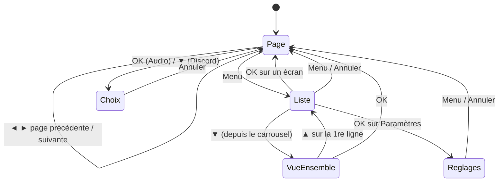

**Ordre de priorité d'une touche** (le premier qui la prend la consomme) :

1. mire de réglage → la ferme ;
2. récapitulatif de fin de partie, résumé d'absence → les ferme ;
3. écran de repos → la touche réveille seulement ;
4. **bandeau affiché** → OK l'ouvre, Annuler le ferme — sauf si un *choix* est ouvert
   (`choosing()` : curseur Audio, panneau d'appel Discord), où OK et Annuler restent au choix ;
5. liste des écrans (carrousel, cartes, grille 4 × 3, liste) ;
6. panneau des ventilateurs, page Audio, panneau Discord ;
7. Menu → liste des écrans ; puis l'action propre à la page.

Pages automatiques : un jeu détecté ouvre la page réglée (`game_page`, GPU par défaut) ; à la fin
de la partie, récapitulatif puis retour à la page d'avant (5 s sans récapitulatif).

---

## 9. Bandeaux et « Ne pas déranger »

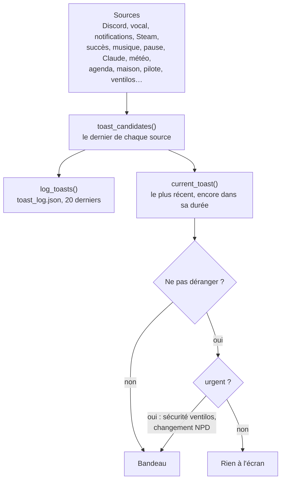

Un candidat est un dictionnaire :

```python
{"at": 1793…, "source": "Discord", "title": "Léa", "body": "on lance à 21h ?",
 "icon": <PIL.Image>, "color": (88, 101, 242), "page": "discord",
 "url": "discord://…", "session": None, "urgent": False, "open": True}
```

`open` : OK peut ouvrir quelque chose (salon Discord, session Claude, page affichée parmi les
pages). Annuler ou OK ferment tous les bandeaux arrivés avant (`toast_closed`).

**Ne pas déranger** : la case se lit dans l'état WNF `WNF_SHEL_QUIETHOURS_ACTIVE_PROFILE_CHANGED`
(`0x0D83063EA3BF1C75`, 0 = désactivé), plus la session de concentration de Windows
(`FocusSessionManager`, que l'appli sait démarrer et arrêter depuis la page Notifs). Relu chaque
seconde. Actif : lune dans la barre du haut, plus de bandeaux ni de clignotements de messages ;
tout reste dans l'historique.

---

## 10. Audio

### Commandes

Tout l'accès COM passe par **un seul fil** ; l'écran lui envoie des commandes :
`("default", id)`, `("profile", p)`, `("master", ±pas)`, `("master_mute",)`, `("mic", ±pas)`,
`("mic_mute",)`, `("app", nom, ±pas)`, `("app_mute", nom)` — pas de 5 %.

### Profils

```python
{"name": "Casque", "out": "NGENUITY - … · HyperX Virtual Audio Device", "out_id": "{…}",
 "in": "", "in_id": "", "volume": None}
```

Un périphérique est retrouvé par son identifiant Windows, sinon par son nom (identifiant changé
après une réinstallation). Sans profil créé : **profils automatiques** casque / haut-parleurs,
devinés par mots-clés (`ngenuity`, `sonar`, `hyperx`, `casque`… ; `haut-parleurs`, `realtek`…).

### Bascule automatique casque / haut-parleurs

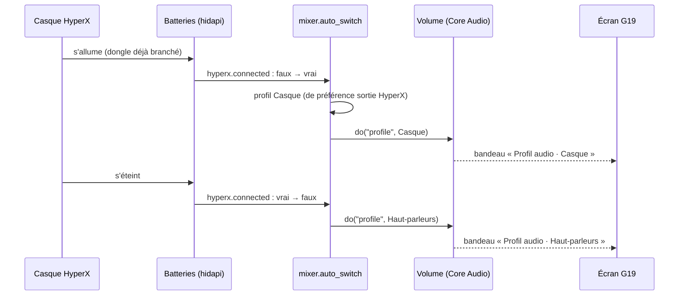

Déclencheurs : passage de `hyperx.connected` (vu chaque seconde), ou sortie de type casque qui
apparaît / disparaît (`volume.changes`). Rien n'est fait si le profil voulu est déjà actif, ou si
le réglage `headset_auto_switch` est coupé (utilitaire → Audio → Casque).

---

## 11. Ventilateurs

Pilotage par LibreHardwareMonitor (sorties PWM de la puce de la carte mère) :

| Profil | auto | silencieux | équilibré | performance | max |
|---|---|---|---|---|---|
| Vitesse | courbe d'origine | 35 % | 55 % | 75 % | 100 % |

Sécurités : la **pompe** et le ventilateur du GPU ne sont jamais touchés ; jamais sous **30 %** ;
retour forcé en auto si CPU ≥ 85 °C ou hotspot GPU ≥ 95 °C (réglables 60–100), et retour au
profil après 60 s passées 8 °C sous les seuils ; auto à la fermeture de l'appli et si la boucle
se fige.

---

## 12. Le voyant Claude

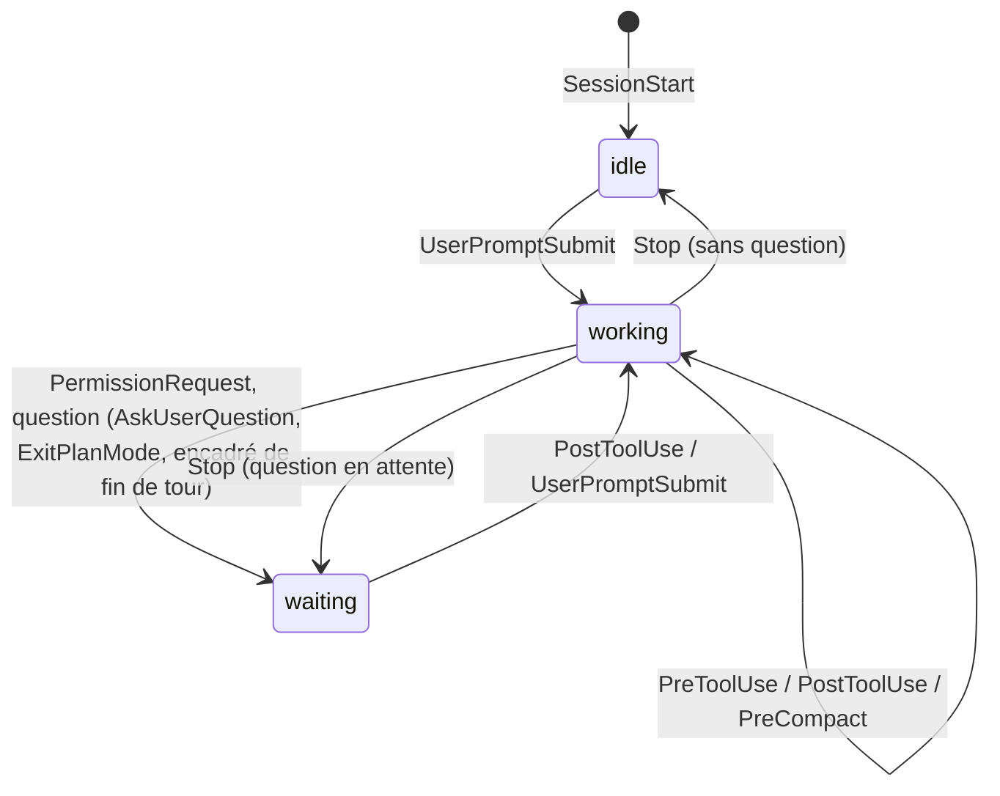

`claude_hook.py` reçoit le JSON de l'événement sur stdin, et écrit
`~/.claude/g19/sessions/<id>.json` :

```json
{"session_id": "…", "started": 1793…, "updated": 1793…, "cwd": "D:\\dev\\g19",
 "state": "waiting", "tool": "", "message": "permission Bash", "pending_question": "…"}
```

Le nom affiché sur le G19 vient du dossier de travail (`cwd`).

- Écriture **atomique** (fichier temporaire puis remplacement, retenté si l'appli lit au même
  instant) sous un verrou `.lock` (création exclusive, 2 s d'attente, verrou périmé après 10 s).
- Un outil arrivé moins de 5 s après `Stop` ne fait pas repasser la session en « travaille »
  (ordre des processus du hook au démarrage).
- Côté appli (`claude_status.py`) : « travaille » périmé après 15 min, « attend » après 30 min,
  « fini » masqué après 2 h, oubli après 12 h. Rappel si une session attend depuis 10 min.
- `claude_usage.py` compte jetons et messages du **bloc de 5 h** en cours et des 7 derniers
  jours, dans les transcripts `~/.claude/projects/**/*.jsonl` (toutes les 30 s).

---

## 13. Instances, gardien, relances

### Objets nommés

| Nom | Type | Rôle |
|---|---|---|
| `Local\G19PCMonitor` | mutex | une seule instance de G19 Monitor |
| `Local\G19PCMonitorQuit` | événement | demande d'arrêt (`--stop`, utilitaire) |
| `Local\G19PCMonitorGuard` | mutex | une seule instance du gardien |
| `Local\G19PCMonitorGuardStop` | événement | « quittée exprès » : le gardien ne relance pas |
| `Local\G19PCMonitorGuardQuit` | événement | arrêt du gardien (son panneau) |
| `Local\G15PCMonitor…` | idem | pour G15 Monitor |

### Le gardien

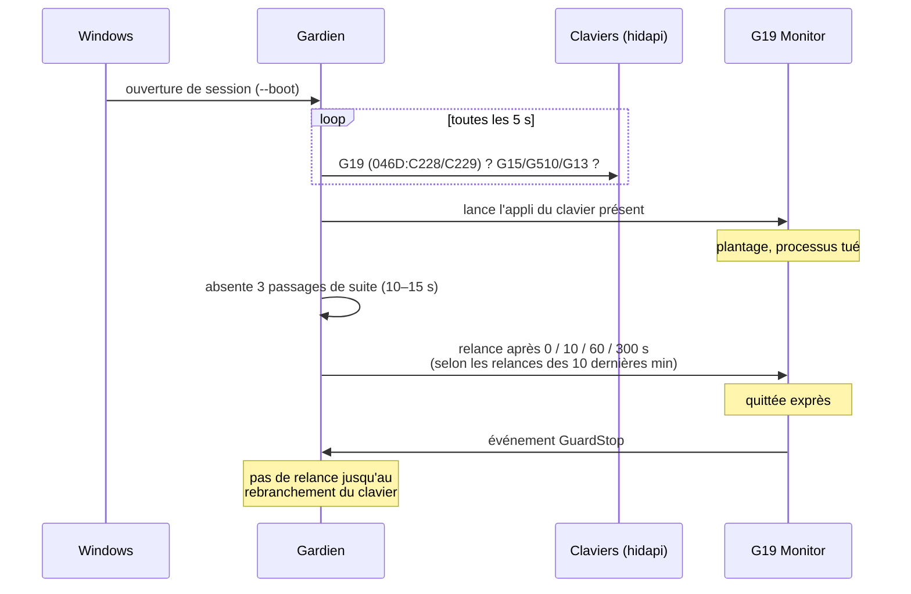

Le gardien relance aussi tout de suite quand le code change (une correction après un plantage),
et publie son état dans `guard_state.json` pour son panneau (`config_guard.pyw`).

### Relance après une modification du code

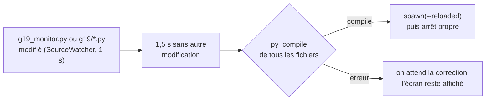

Une appli qui plante juste après une modification attend la correction du code au lieu de
laisser l'écran éteint. Au démarrage, `G19_WAIT_PID` fait attendre la fin de l'ancienne
instance.

---

## 14. Mises à jour

Le dossier de l'appli est un clone git de `fauwzk/g19-monitor`.

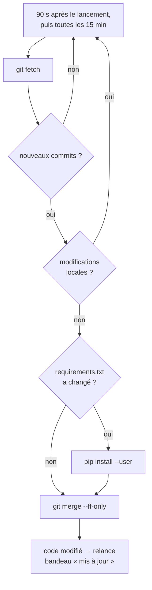

`GIT_TERMINAL_PROMPT=0` : jamais de fenêtre de connexion. La version affichée (menu, utilitaire)
est le hash court et la date du commit (`version.py`).

---

## 15. Utilitaire ↔ appli

L'utilitaire ne parle jamais directement à l'appli :

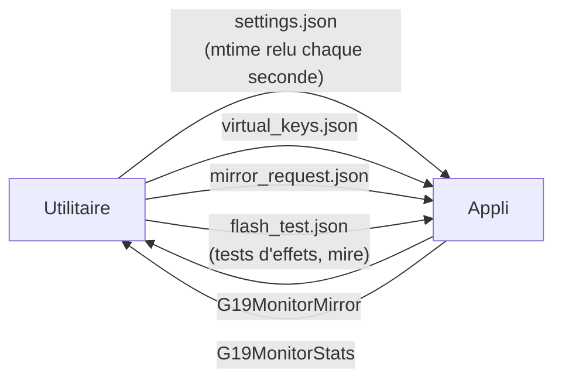

| Canal | Format |
|---|---|
| `settings.json` | réglages complets ; chaque enregistrement garde la version précédente dans `settings.bak.json` (reprise si illisible) et note qui a changé quoi dans `settings_changes.log` |
| `virtual_keys.json` | `{"keys": [[n, "ok"], [n+1, "right"], …]}` — 30 dernières ; l'appli ne prend que les numéros plus grands que le dernier vu |
| `mirror_request.json` | `{"at": t}` rafraîchi chaque seconde ; l'appli copie l'image tant qu'il a moins de 3 s |
| **`G19MonitorMirror`** (mémoire partagée nommée) | en-tête `<dQ` (horodatage, n° d'image) puis 320 × 240 × 3 octets RGB ; l'en-tête est écrit **en dernier** (image complète) ; jusqu'à 60 i/s |
| **`G19MonitorStats`** (mémoire partagée nommée) | `<ddd` : horodatage, images/s réellement parties vers le G19, réglage ; toutes les 2 s |

---

## 16. Fichiers de données

Tout est dans `%LOCALAPPDATA%\G19Monitor` (sauf le journal et les sessions Claude) :

| Fichier | Contenu |
|---|---|
| `settings.json`, `settings.bak.json`, `settings_changes.log` | réglages |
| `state.json` | page affichée au dernier arrêt, vue GPU |
| `games.json` | 300 dernières parties (≥ 60 s) : durée, FPS, températures, puissance, courbe |
| `history.json` | 24 h, une mesure par minute (enregistré toutes les 5 min) |
| `day_log.json` | bilan du jour, 14 jours (enregistré chaque minute) |
| `toast_log.json` | 20 derniers bandeaux |
| `speedtest.json`, `speedtests.csv` | tests de débit |
| `steam_seen.json`, `store_lookup.json`, `covers/` | caches Steam, pochettes |
| `weather_place.json` | ville de la météo |
| `guard_state.json` | état du gardien |
| `virtual_keys.json`, `mirror_request.json`, `flash_test.json` | échanges avec l'utilitaire |
| `steam_api.json`, `discord.json`, `home_assistant.json`, `calendar.json` | **accès personnels** |
| `g15_settings.json` | réglages de G15 Monitor |

Ailleurs : `g19.log` (dossier de l'appli, tournant), `~/.claude/g19/sessions/*.json`.

---

## 17. Dépannage

| Symptôme | Où regarder |
|---|---|
| Écran noir, « en attente de LGS » | LGS lancé ? Réessai toutes les 5 s. |
| Fluidité basse ou saccades | ligne `boucle :` de `g19.log` (temps par étape, tâches les plus lentes) ; fluidité sous l'aperçu de l'utilitaire. |
| Écran figé | `g19.log` : pile des fils écrite par le Watchdog après 45 s. |
| Rétroéclairage qui ne change plus | LGS → « Permettre le contrôle de l'éclairage par le jeu ». |
| Une page a disparu | Discord, Docker, Maison, Agenda, Carburant sont masquées tant que leur service manque. |
| Plantages répétés | `g19.log` (« tâche … en erreur », « plantage ») ; relances espacées par le gardien. |
| Voyant Claude bloqué | `~/.claude/g19/sessions/` ; hooks réinstallés par l'utilitaire (Système → Voyant Claude). |
